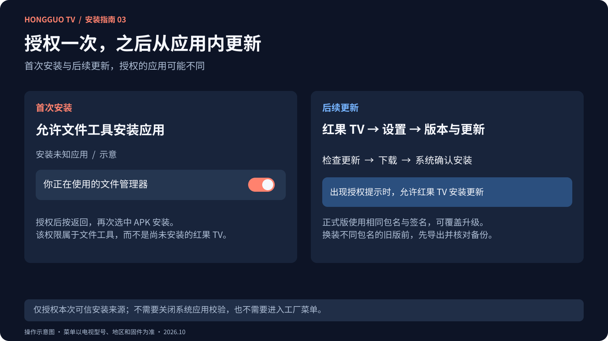
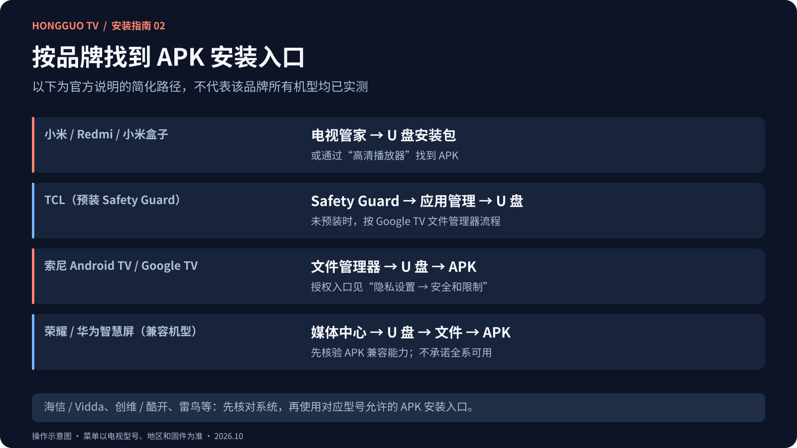
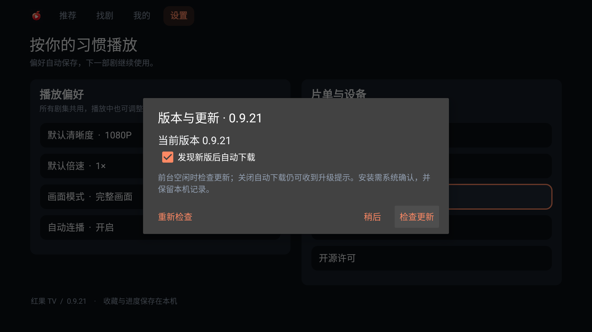

# 红果 TV 安卓电视安装图文教程｜小米、海信、TCL、创维等品牌

**免费下载安装，无需登录，无需 App 会员。** 本页帮助你先确认电视是否兼容，再通过 U 盘或设备支持的文件传输方式安装红果 TV。

[免费下载正式 APK](https://tv-admin.curatedlifefinds.com/download) · [GitHub 备用下载](https://github.com/ljl215186/hongguoTV-updates/releases/latest) · [返回功能介绍与界面截图](README.md)

说明核对日期：**2026-10-20**。教程根据厂商公开说明整理；系统菜单会随型号、地区和固件变化。三张配图为本项目制作的**操作示意图，不是各品牌系统截图**；厂商原图与完整步骤可打开对应官方链接查看。

## 安装前：确认系统，而不只看电视品牌

红果 TV 当前 APK 要求 **Android 8.0 / API 26 或更高版本**，并且设备允许安装本地 APK。先在电视 **设置 → 关于 / 设备信息 / 系统信息** 中查找 Android 版本；找不到时，以该型号说明书或厂商客服答复为准。酷开、聚好看、MagicOS、HarmonyOS、HyperOS 等产品或界面版本号不能直接当作 Android 版本号。

| 你的电视系统 / 状态 | 安装建议 |
|---|---|
| Android 8.0+，开放本地 APK 安装 | 使用下方 U 盘流程与对应品牌教程。 |
| Android TV / Google TV，符合最低版本 | 使用支持 APK 的文件管理器；按提示为安装来源授权。 |
| Android 低于 8.0 | 当前 APK 不支持；先确认厂商是否提供兼容系统升级。 |
| Android 系统，但固件禁止第三方安装 | 先向厂商核实本机允许的安装方法；本教程不保证能解除固件限制。 |
| 荣耀 / 华为智慧屏 | 官方部分型号支持第三方安装，但仍需确认 Android APK 兼容能力与本 App 的最低要求，未完成本项目实机验收。 |
| 三星 Tizen、LG webOS、VIDAA、Roku、Titan OS 等非 Android 系统 | 当前 APK 不支持直接安装。可将兼容的 Android 盒子连接电视 HDMI，在盒子上安装。 |

例如，海信官方支持页分别说明了 Google TV 与 VIDAA 的菜单，不能把一种系统的步骤套用另一种；三星、LG 也使用各自的电视应用平台。参考：[海信系统区分](https://www.hisense.com.br/suporte)、[三星 Tizen 应用说明](https://www.samsung.com/sg/support/tv-audio-video/how-to-install-and-uninstall-apps-on-your-samsung-tv/)、[LG webOS 应用说明](https://www.lg.com/us/support/help-library/lg-tv-how-to-install-or-delete-apps--20153192472469)、[VIDAA 开发指南](https://www.vidaa.com/wp-content/uploads/2020/12/WebApp_Development_Guide_for_VIDAA.pdf)、[Titan OS 应用平台](https://www.titanos.tv/apps)。

**验证范围：** 本项目已在 Android 9 指定测试设备验证安装、播放及更新；本文不把厂商通用安装说明当作本 App 的逐品牌认证。反馈兼容问题时，请提供型号、Android 版本、App 版本及出错画面。

## U 盘安装：通用六步图解

### 第一步：下载正式 APK

在电脑打开 **[红果 TV 下载页](https://tv-admin.curatedlifefinds.com/download)**，下载正式版。GitHub 用户也可进入 [Releases](https://github.com/ljl215186/hongguoTV-updates/releases/latest)，展开 **Assets / 资源**，点击带版本号的 `.apk` 附件。

- 正确示例：`hongguotv-0.9.21-release.apk`，安装新版时以下载页版本为准。
- `Source code (zip)`、`Source code (tar.gz)` 是 GitHub 自动生成的仓库压缩包，不能用于电视安装。
- APK 不需要解压，不需要改后缀，也不需要先安装另一个“红果”应用。

### 第二步：复制到 U 盘

将 APK 直接复制到 U 盘根目录，方便电视查找。根据电视说明书选择支持的 U 盘容量与文件系统；例如 TCL 所引官方 USB 教程要求 **FAT32、容量不超过 32 GB**，这不是所有品牌的统一限制。[TCL 官方说明](https://www.tcl.com/ru/ru/support-tv/faq/38300)

U 盘已有资料时先备份，不要为了尝试安装直接格式化。

### 第三步：打开电视的文件工具

将 U 盘插入电视 USB 接口。看到外接设备提示时选择浏览；没有提示时，从应用列表打开该机型的文件管理器、媒体中心或 APK 安装工具。

选择 **U 盘 → 全部文件 / 文件 / 安装包**。若只进入“图片、音乐、视频”分类，APK 可能被隐藏。不同品牌的具体入口见下方教程。

### 第四步：选中安装包，按 OK

找到 `.apk` 文件，按遥控器 **OK / 确认**。如果当前媒体播放器不支持 APK，请改用该设备允许的文件管理工具。出现 Android 系统安装器后，确认应用名称并选择 **安装**。

### 第五步：按提示为安装来源授权

首次安装可能出现“不允许安装未知应用”。选择提示中的 **设置**，为**刚才打开 APK 的文件管理器**允许安装，再按返回，重新选中 APK 完成安装。各固件的授权名称和位置不同。[索尼官方安全设置说明](https://helpguide.sony.net/tv/hga2/v1/zh-cn2/print.html)

“允许安装未知应用”与“关闭应用安全校验”是两项功能。仅为本次可信安装来源授权，无需关闭系统校验或进入工厂菜单。[Android TV 官方安全说明](https://support.google.com/androidtv/answer/12188351?hl=zh-Hans)

### 第六步：打开红果 TV

安装完成后选择 **打开**，或从电视 / 盒子的应用列表启动红果 TV。联网后进入推荐或找剧，无需登录、注册或购买 App 会员。方向键移动焦点，OK 确认，返回逐层退出；推荐内容区域可用上下键换剧。

## 各品牌安卓电视安装教程

[小米 / Redmi](#xiaomi) · [海信 / Vidda](#hisense) · [TCL / 雷鸟](#tcl) · [创维 / 酷开](#skyworth) · [长虹 / CHiQ](#changhong) · [康佳](#konka) · [海尔 / 卡萨帝](#haier) · [索尼](#sony) · [飞利浦 / 夏普](#philips-sharp) · [荣耀 / 华为智慧屏](#smart-screen) · [Android 盒子 / 投影仪](#android-box)

### 小米 / Redmi 电视、小米盒子

适用条件：符合 Android 8.0+ 要求，且该型号固件允许安装本地 APK。

1. 完成前文的 APK 下载和 U 盘复制，将 U 盘插入电视或盒子。
2. 打开 **电视管家 → U 盘安装包**；也可通过 **高清播放器** 找到安装包。以本机实际提供的入口为准。
3. 选中红果 TV APK，按 OK；若出现安装来源限制，按系统提示进入设置并允许当前来源。
4. 返回安装包确认安装，完成后从应用列表打开红果 TV。

小米官方明确提供 U 盘安装包与高清播放器两种入口。[小米官方安装说明](https://www.mi.com/global/support/article/KA-06405/)、[无法安装本地软件的官方排查](https://www.mi.com/tw/support/faq/details/KA-05404/)。海外 Android TV / Google TV 版本的菜单可能不同，可使用支持 APK 的文件管理器；没有 USB 接口的电视棒参考 [无 U 盘方案](#without-usb)。

### 海信 / Vidda

**先区分系统：** 本段只面向符合要求的 Android 机型。VIDAA / Roku 机型不能按 Android APK 流程安装本 App；海信不同地区的产品系统并不相同。[海信官方系统与应用说明](https://www.hisense.com.br/suporte)

1. 在系统信息中核对 Android 版本及具体型号。
2. 插入装有 APK 的 U 盘，从本机提供的 **文件管理 / 媒体中心 / U 盘浏览** 工具查找“全部文件”或“安装包”。这些是查找入口的提示名称，不是全系列统一菜单。
3. 若能选中 APK 并打开系统安装器，按 [通用授权步骤](#usb-install) 安装。
4. 若 U 盘只能播放媒体、APK 被隐藏或明确提示禁止安装，向该型号售后确认支持的本地安装方式。不要把网上“海信专版”的重命名或工厂菜单教程直接套用本包。

**资料状态：** 已核对官方 Android / VIDAA 系统差异，尚未找到适用于全部国内海信 / Vidda 固件的官方 APK 菜单说明；本段为条件式查找流程，不代表该品牌实测通过。

### TCL / 雷鸟

TCL 官方海外 Google TV 教程分为两种情况，国内 TCL / 雷鸟系统的入口可能不同，须先确认 Android 版本和本地安装能力。

1. 把 APK 放入 U 盘并插入电视。
2. **已预装 Safety Guard 的 TCL：** 打开 **Safety Guard → 应用管理 → U 盘**，选中 APK 安装。
3. **没有 Safety Guard 的 Google TV：** 使用支持 USB 与 APK 的文件管理器，选择 U 盘和安装包；按提示允许该文件管理器安装未知应用，再返回安装。
4. **国内 TCL / 雷鸟：** 从本机的文件工具查找 U 盘“全部文件 / 安装包”。若当前固件没有 APK 安装入口，按具体型号向售后核实，不能凭 TCL 海外教程认定可安装。

参考：[TCL 官方 USB 安装图文说明](https://www.tcl.com/ru/ru/support-tv/faq/38300)、[TCL 官方 Safety Guard 图文说明](https://www.tcl.com/ru/ru/support-tv/faq/36461)（俄文页面，可使用浏览器翻译）。这两篇只用于其注明的平台和预装条件，不表示雷鸟采用相同菜单。

### 创维 / 酷开

适用条件：Android 8.0+，固件开放第三方 APK 安装。

1. 先查看系统信息，确认 Android 版本；酷开 OS 的营销版本号不能代替 Android 版本。
2. 插入 U 盘，在电视现有文件工具中查找 **外接存储 → 全部文件 / 安装包**。
3. 能打开 APK 时，按系统提示授权并安装；如果只显示媒体文件，先核对该工具是否支持 APK。
4. 若本机未提供本地 APK 安装功能，记录型号、固件版本，向官方确认当前政策。网上针对旧固件的暗码、开发容器教程不作为本项目安装要求。

**资料状态：** 未核实到覆盖当前全部酷开固件的官方消费端 APK 安装步骤，本段仅说明查找和核对方法。[创维官方售后服务](https://www.skyworth.com/service.php)

### 长虹 / CHiQ

1. 核对本机是 Android 8.0+，并支持用户安装 APK。
2. 插入 U 盘，通过本机文件工具进入外接存储，查找全部文件或安装包。
3. 选中红果 TV APK，进入安装器后按提示授权并安装；完成后从应用列表启动。
4. 没有安装入口时，按型号查询官方说明，不使用旧版自动安装脚本。

**资料状态：** 长虹官方有 U 盘安装应用的历史介绍，但并未证明所有新固件开放安装；旧型号的开机自动安装方法不适用于本教程。[长虹官方历史说明](https://cn.changhong.com/fw/cjwt/czzd/qt_1030/201607/t20160731_55656.html)

### 康佳

1. 在本机系统信息中确认 Android 8.0+ 与型号。
2. 通过设备自带的文件浏览工具打开 U 盘，切到“全部文件 / 安装包”查找 APK。
3. 若允许启动系统安装器，按照提示允许当前文件工具安装，然后确认安装。
4. 若固件禁止本地安装，向官方服务中心提供型号和固件版本核实，或使用兼容的外接 Android 盒子。

**资料状态：** 尚未核实到康佳全系列通用的官方 APK 安装菜单；以上为满足安装条件时的通用操作，不表示已在康佳实机验收。[康佳官网与服务入口](https://www.konka.com/)

### 海尔 / 卡萨帝

1. 按具体型号核对 Android 版本及本地 APK 安装支持，不能只根据“智能电视”判断。
2. 插入 U 盘，用该机型提供的文件工具浏览全部文件；仅有影音播放功能时，先核对是否另有安装包入口。
3. 能启动 APK 安装器时，按通用授权步骤安装红果 TV。
4. 若不支持 APK，停止套用其他品牌的菜单路径，转查该型号说明书或使用外接 Android 盒子。

**资料状态：** 官方产品支持中心提供型号说明书查询；未核实到适用海尔 / 卡萨帝全系列的统一 APK 安装教程。[海尔官方产品支持](https://www.haier.com/support/)

### 索尼 BRAVIA Android TV / Google TV

1. 确认本机为 Android TV / Google TV，且满足 Android 8.0+；非 Android 老款 BRAVIA 不适用。
2. 把 APK 放入 U 盘，用支持 APK 的文件管理器打开。系统自带的照片 / 视频播放器不一定支持安装包。
3. 如提示没有安装权限，可按系统提示跳转；索尼所引帮助指南列出的路径为 **快速设置 → 设置 → 隐私设置 → 安全和限制 → 未知来源 → 安装未知应用**。
4. 为刚才的文件管理器允许安装，返回 APK 确认安装。完成后从应用列表打开红果 TV。

参考：[索尼官方安全设置帮助](https://helpguide.sony.net/tv/hga2/v1/zh-cn2/print.html)（页内搜索“未知来源”）、[索尼官方 Android TV / Google TV 类型说明](https://www.sony.com/electronics/support/articles/00147386)。旧固件的菜单位置可能不同，以当前安装提示为准。

### 飞利浦 / 夏普 Android TV / Google TV

**飞利浦：** 确认是 Android TV / Google TV 型号。将 APK 复制到 U 盘，用支持 APK 的文件管理器打开；按提示允许该来源安装，再返回确认。飞利浦 Android TV 文档提供过 **设置 → 设备偏好设置 → 安全和限制** 下的来源授权方法，具体以机型为准。[飞利浦官方 Android TV 安装说明 PDF](https://www.documents.philips.com/assets/20230824/a8796f77fcac422ca7b0b0680079a0ed.pdf)

**夏普：** 仅在核对为 Android 8.0+、允许 APK 安装后使用通用 U 盘流程。部分 AQUOS 官方手册包含 **Security & restrictions / 安全和限制 → Unknown sources / 未知来源** 设置；这些是特定型号手册，不能推出全部 AQUOS 支持当前 App。[夏普官方型号手册 PDF](https://sg.sharp/sites/default/files/uploads/files/8TC60AX1X-8TC70AX1X-8TC80AX1X_sg1_en.pdf)

飞利浦的 Titan OS / SAPHI，以及夏普采用其他非 Android 系统的机型，不在本 APK 的直接支持范围。请先查型号系统，不要仅凭品牌选择教程。

### 荣耀智慧屏 / 华为智慧屏：先确认兼容能力

**这两类设备暂不作为本项目已验证支持机型。** 厂商提供第三方安装入口，只能说明部分设备具备安装能力，不代表一定符合本 App 的 Android API 与播放器要求。

**荣耀智慧屏：** 官方路径为 **媒体中心 → U 盘 → 文件**，选择 APK，按确认，依系统提示继续安装；安装后在全部应用打开。建议 APK 放在 U 盘根目录，避免部分型号对中文目录的兼容问题。[荣耀官方应用管理图文教程](https://www.honor.com/cn/support/content/zh-cn15812201/)、[荣耀官方 U 盘安装失败排查](https://www.honor.com/cn/support/content/zh-cn15812308/)

**华为智慧屏：** 在支持第三方安装的型号上，官方列出的入口为 **全部应用 → 本机 → 媒体中心 → U 盘 → 文件**，或 **全部应用 → 媒体中心 → U 盘 → 文件**，再选择安装包。具体适用型号与限制请先查看官方页面。[华为官方安装第三方应用图文教程](https://consumer.huawei.com/cn/support/content/zh-cn01089258/)

如果设备不支持 Android APK、API 不满足要求或安装器拒绝，不通过修改扩展名解决；可改用外接兼容 Android 盒子。HarmonyOS / MagicOS 的版本号不能直接与 Android 8.0 比较。

### 其他 Android 电视盒子 / 投影仪

小米盒子、当贝盒子、天猫魔盒、腾讯极光盒子及其他 Android 设备，请**逐型号确认 Android 8.0+、APK 安装权限和遥控器兼容性**；品牌旧款不一定达到最低系统要求，也未完成本项目逐型号认证。

1. 电视盒子通过 HDMI 连接电视，并切换到相应信号源；在盒子本身安装 APK，而不是电视的另一套系统。
2. 有 USB 接口时，按 [U 盘六步流程](#usb-install) 安装；投影仪同样核对其实际 Android 系统和文件工具。
3. 安装完成后从盒子 / 投影仪应用列表打开红果 TV，测试方向键、OK、返回及播放声音。

## 没有 U 盘或 USB 接口怎么办

- **设备自带局域网传文件：** 电脑 / 手机与电视连接同一局域网，使用电视提供的接收功能发送正式 APK，再通过文件工具安装。
- **设备已有浏览器或下载工具：** 打开本项目 [下载页](https://tv-admin.curatedlifefinds.com/download)，下载后按系统提示为该来源授权并安装。
- **Google TV / Android TV：** 如需另装文件管理器或传输工具，从系统支持的应用商店获取；商店可能要求系统账号，这是工具或商店的要求，红果 TV 本身无需登录。

以上方法取决于设备实际提供的功能。红果 TV 没有要求你先在品牌应用商店搜索同名 App；本项目安装包来自上方下载页及公开 Release。

## 安装后如何更新、如何保留记录

在红果 TV 打开 **设置 → 版本与更新**，检查并下载新版，由 Android 系统确认安装。首次应用内更新可能需要为 **红果 TV** 允许安装未知应用；这与首次 U 盘安装时为**文件管理器**授权不同。

同包名、同正式签名的新版可覆盖升级并保留记录。当前包名为 `com.ljl215186.hongguotv`；不同包名的旧版可先在 **设置 → 手机备份与恢复** 导出 JSON，在新版导入并核对收藏、历史和设置。确认恢复前保留旧应用，不要先卸载。

## 安装失败与常见问题

| 遇到的情况 | 先这样处理 |
|---|---|
| U 盘里看不到 APK | 切到全部文件 / 安装包，核对文件没有变成 `.apk.zip`；使用支持 APK 的文件工具。 |
| 电视无法识别 U 盘 | 先检查接口，再按型号手册核对文件系统和容量；更换 U 盘前保留已有资料。 |
| 提示不允许安装未知应用 | 为当前打开 APK 的文件工具授权，再返回重试；后续应用内更新则按提示授权红果 TV。 |
| 提示安装包解析失败 | 核对 Android 8.0+，重新下载完整的 `.apk`；不要用 Source code 压缩包或网页文件。 |
| 提示“应用未安装”或签名冲突 | 核对是否已有同包名的其他签名测试版，先备份记录；不要直接卸载正在使用的版本。 |
| Android 9 旧测试版误报更新签名 | 0.9.19 及更早版可改由文件管理器安装 0.9.21 或更新正式版；同包名同签名时覆盖安装。 |
| 只显示商店应用，禁止本地安装 | 向厂商确认该固件支持的方法；本教程不要求关闭应用校验、输入工厂暗码或恢复出厂设置。 |
| 安装成功但找不到图标 | 从系统应用列表或设置的已安装应用中查找“红果 TV”，核对刚才安装是否成功。 |
| 无法播放或出现缓冲 | 先检查网络、换剧、降低清晰度；安装成功不代表每个内容源都稳定。 |

仍有问题，请到 [公开仓库 Issues](https://github.com/ljl215186/hongguoTV-updates/issues) 提交 **品牌 / 型号、Android 版本、App 版本、安装方式和错误截图**。不要上传口令、完整私人备份或个人观看记录。

## 图文来源与维护

厂商官方资料已链接在对应步骤旁。TCL 的两篇安装说明及荣耀、华为的应用管理页包含厂商原始图文；外语页面可使用浏览器翻译。对缺少当前统一官方教程的品牌，本页明确使用条件式流程，不伪造机型实拍或宣称全系认证。

三张原创示意图设计源文件：[Figma · 红果 TV 电视安装图解](https://www.figma.com/design/I9JyZD6L7p9KpesD1uFpES)。图解与本仓库界面截图随文档保存，不依赖第三方图片外链。

**[下载免费红果 TV](https://tv-admin.curatedlifefinds.com/download)** · [查看全部应用截图](README.md#界面实拍从找剧到播放) · [反馈安装问题](https://github.com/ljl215186/hongguoTV-updates/issues)
