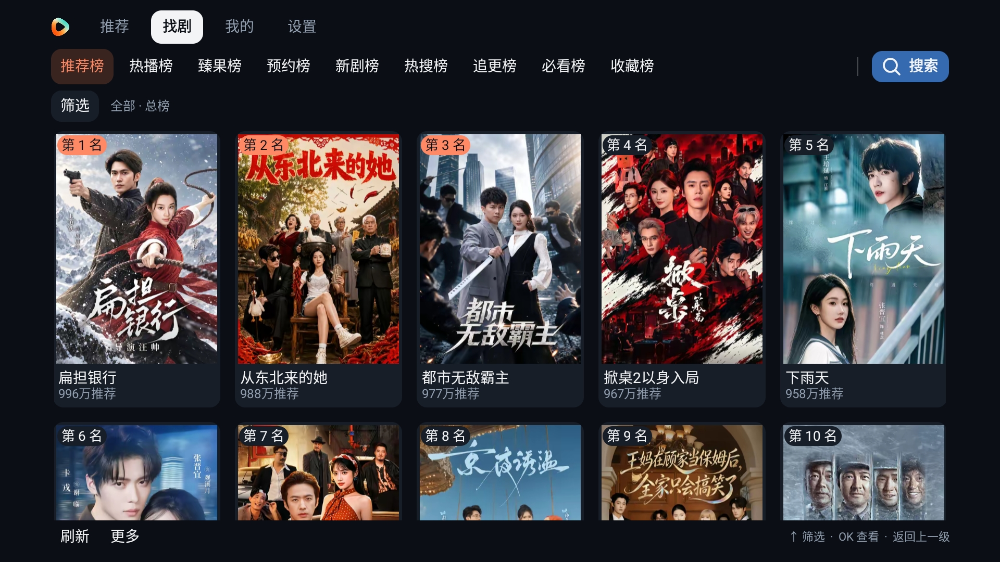
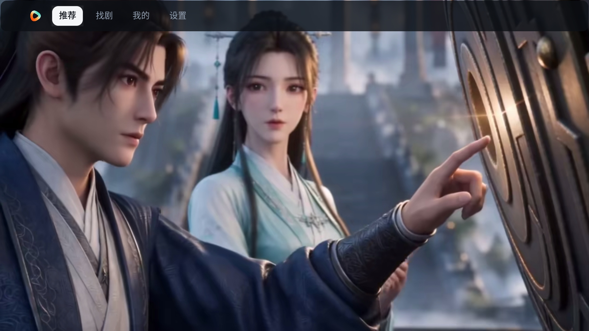
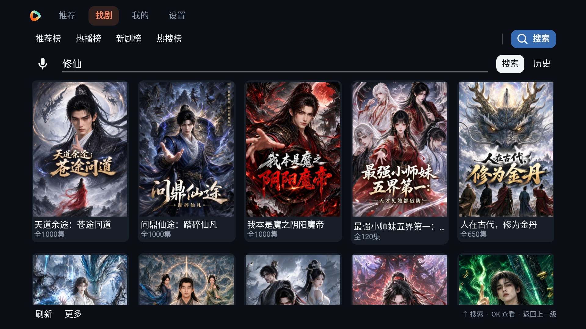
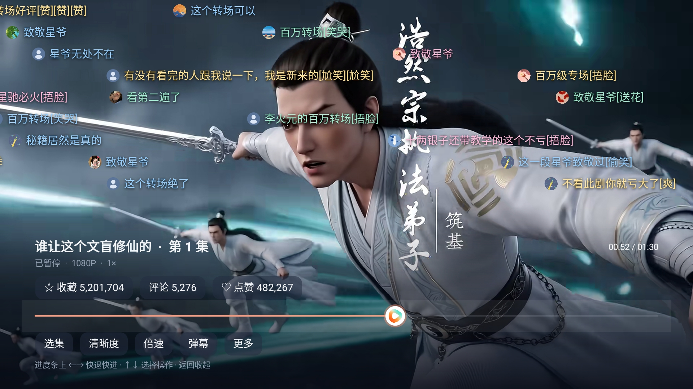
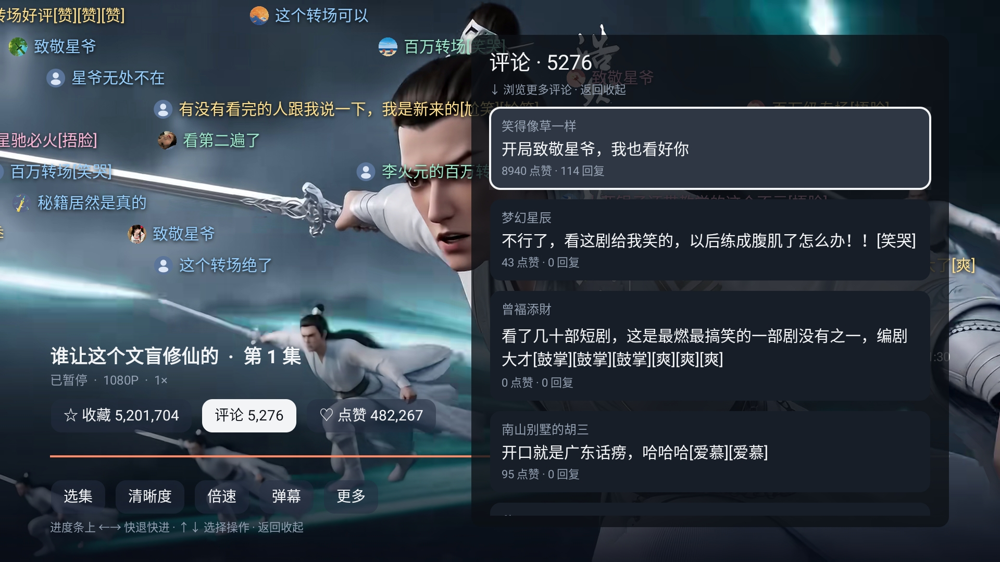
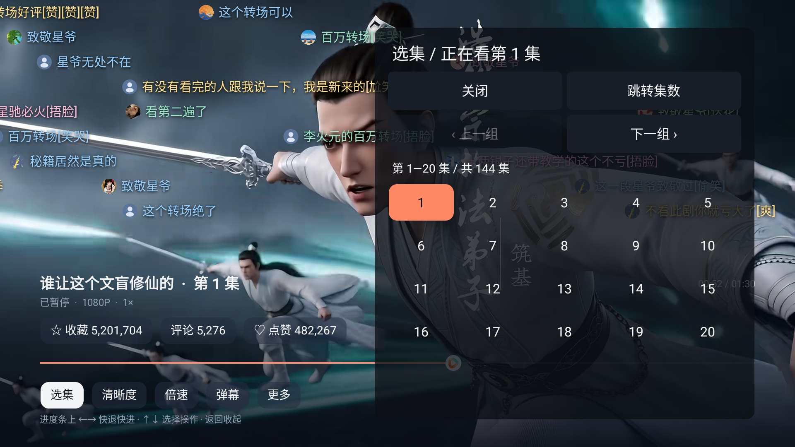
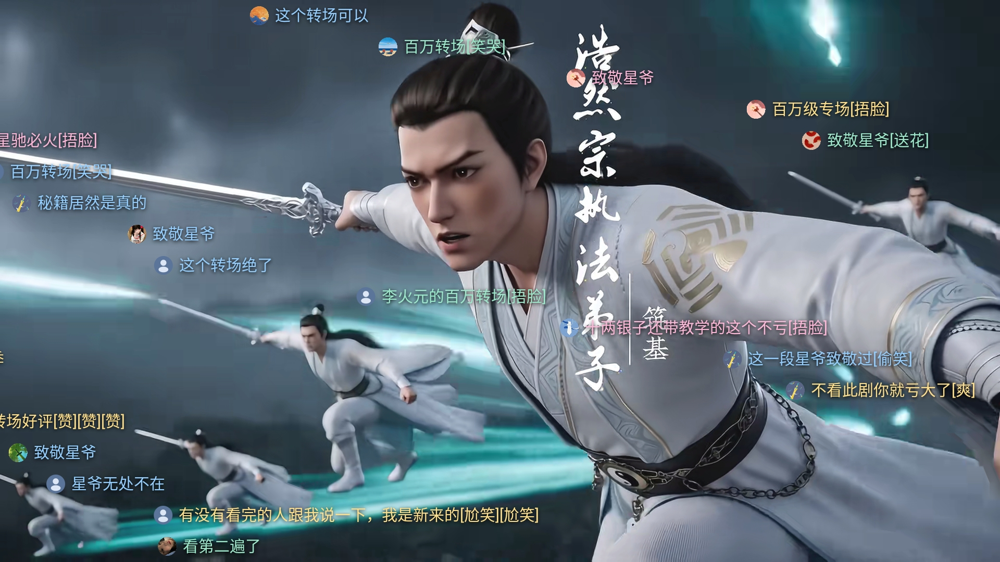
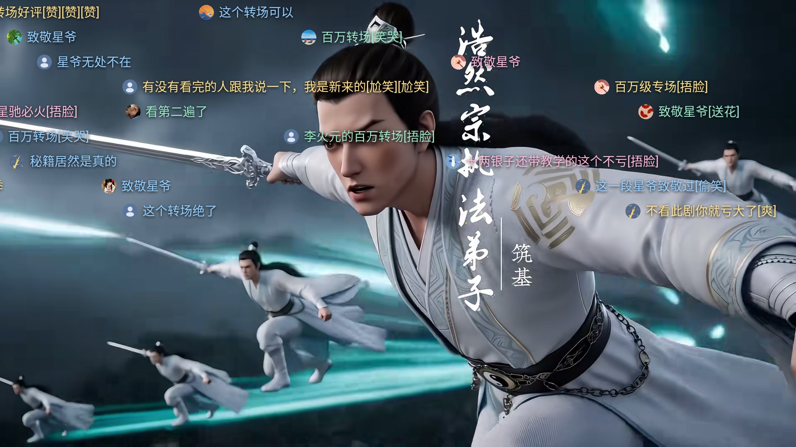
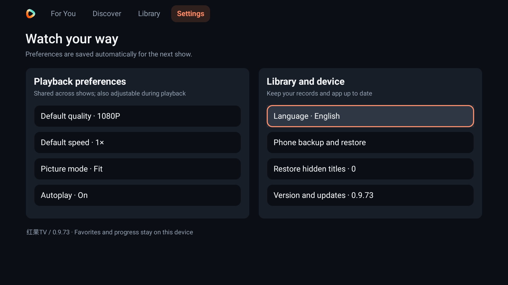

# Hongguo TV | Free Android TV Dramas, Account Sync and Colorful On-screen Comments

[简体中文](README.md) · [繁體中文](README.zh-TW.md) · [English](README.en.md)

**Short dramas and comics on your TV. Choose guest viewing or account sync, like and save shows, and watch with colorful on-screen comments.**

Hongguo TV is a free client for Android TVs, TV boxes and compatible streaming devices. Explore recommendations, rankings, live-action dramas and comics, or search for a title. Watch as a guest, or sign in to your Hongguo account by phone number to load favorites, history and liked-title lists automatically. Like and save shows from the player, merge local records when needed, browse comments and enjoy colorful on-screen messages with round avatars. Episode groups, playback speed and resume controls work with a remote.

**[Download the APK](https://hongguotv-egb.pages.dev/)** · [GitHub Releases mirror](https://github.com/ljl215186/hongguoTV-updates/releases/latest) · [Report a problem](https://github.com/ljl215186/hongguoTV-updates/issues)

Android 8.0+ · Current version **0.9.75** · Package: `com.hongguo.tv` · Three interface languages

**Telegram:** [Release channel](https://t.me/HongGuoTVPublish) · [Community and feedback](https://t.me/HongGuoTVJiaoLiu)

| Release channel | Community |
|---|---|
|  |  |

The development preview also adds a “Show details” button above library lists and dynamic extension pages. A dedicated Community page brings together the release channel and discussion group. The download page identifies the current public release.

**Latest changes:** on-screen messages default to multiple colors in the upper half, leaving more space below. Choose full-screen or off, and adjust transparency, speed and color. Existing saved choices are preserved. See the **[complete screenshot gallery](SCREENSHOTS.md)**.

This is an unofficial client for personal research, learning and technical exchange. Third-party works and marks belong to their owners. Use within your legal authorization; see the [disclaimer, in Chinese](DISCLAIMER.md).

## Free viewing, optional account features

| Feature | What you get |
|---|---|
| Free app | No paid app membership or episode-unlock purchase flow. |
| Optional login | Watch as a guest or sign in to your own Hongguo account by phone number. |
| Account sync and merging | Automatically load account favorites, history and liked titles; merge local records when needed. |
| Likes and favorites | Like and save shows from the full-episode player, with status and counts on the buttons. |
| Made for a remote | Large posters, visible focus, directional navigation and transparent playback controls. |
| Continuous viewing | Next-episode preparation, autoplay, resume, quality, speed and picture settings. |
| Colorful messages and comments | Multicolor upper-half messages with round avatars by default; adjust coverage, transparency, speed and color, and browse more comments with Down. |
| Three languages | Simplified Chinese, Traditional Chinese and English in Settings → Language. |

## Four main sections

- **For You:** full-screen previews. Up/down changes titles, OK opens the full show, and Back reveals navigation.
- **Discover:** rankings, live-action/comic filters and search with pagination. A failed request can be retried without losing the current page.
- **Library:** Login, Continue watching, Favorites and Watch later for guests; account information and liked-title lists are available after login.
- **Settings:** default quality, speed, picture mode, autoplay, language, phone backup/restore and updates.

Login is optional. Enter verification codes only on your own device. Account lists are stored separately; failed account requests keep the previous state. QR login is not available, and history or merged local records are not automatically uploaded.

## New screenshots

These are actual screens from an Android 9 test device at 1920×1080. Colorful messages and player interactions were recaptured with **0.9.75**; other pages use the 0.9.73 / 0.9.74 gallery. See the **[full functional gallery](SCREENSHOTS.md)** for more menus and settings.

| Recommendations | Search |
|---|---|
|  |  |

| Playback controls | Comment list |
|---|---|
|  |  |

| Episode groups | Optional login |
|---|---|
|  |  |

| Full-screen messages | Upper-half messages |
|---|---|
|  |  |

Both colorful-message screenshots use the same episode and playback position. Upper-half is the default; full-screen uses the entire playback area. Round avatars use real public profile data, with a default image when unavailable.

## Remote control guide

| Where you are | Controls |
|---|---|
| Top navigation | Left/right switches sections; OK or Down enters the content. |
| Recommendation preview | Up/down changes titles; OK opens the full show. Left/right or Menu reveals controls. |
| Full episode | Up/down changes episodes; OK pauses/resumes. |
| Playback controls | The first left/right press only reveals controls. The timeline icon marks focus; left/right seeks and up/down selects actions. |
| Menus and comments | Directions operate the current panel. Back closes one layer at a time; returning to recommendations reveals the top navigation. |
| Pagination and episode groups | Focus the paging button and press OK. Focus remains on that button; the last page does not advance to an empty page. |

Playback smoothness depends on the device, connection and content source. Lower the quality or retry if buffering occurs. Test-device screenshots do not certify every TV brand or system voice service.

## Supported TVs and streaming boxes

The APK requires **Android 8.0 / API 26 or newer**, local APK installation support and compatible playback hardware. Check the actual Android version, not just a brand or launcher version. Support varies by model, region and firmware; these are installation conditions, not brand-wide device certifications.

Android models from Xiaomi/Redmi, Hisense/Vidda, TCL/FFALCON, Skyworth/Coocaa, Changhong/CHiQ, Konka, Haier/Casarte, Sony BRAVIA, Philips and Sharp may meet these conditions. See the [brand-by-brand TV guide, in Chinese](INSTALL.md#brand-guides). Huawei/Honor screens still require model-specific compatibility checks.

Samsung Tizen, LG webOS, VIDAA, Roku, Titan OS, Apple TV/tvOS and Vega OS cannot directly run this Android APK. A compatible external Android box can be connected to the TV over HDMI.

### Install on a TV box

Connect the box to your TV, select its HDMI input and use the **box remote**. Install the APK on the box, rather than in the TV's separate operating system.

1. Open the [download page](https://hongguotv-egb.pages.dev/) on your computer or phone and download the release `.apk` file. Do not download or extract Source code archives.
2. Copy the APK to a USB drive and insert it into the box. Open it with a file manager that supports APK files; choose All files or Installation packages if needed.
3. When Android asks, allow **that file manager or download tool** to install unknown apps. Return to the installer and confirm installation.
4. Open Hongguo TV from the box's Apps list. No app login or membership is required.

The image is a generic illustration, not a screenshot of every brand's firmware.

| Box / device | Installation approach |
|---|---|
| **Xiaomi Box / Xiaomi TV Box S / Mi Box S** | Domestic firmware may provide TV Manager → USB installation packages or an HD player. Overseas models may need a file manager from their store. Wireless transfer is another option. [Xiaomi official instructions](https://www.mi.com/tw/support/article/KA-17660/) |
| **Dangbei** | Put the APK on USB, browse the installation file and confirm. Existing Dangbei tools may offer Remote push/Remote install over your local network. [Official USB guide](https://sp.dangbei.com/cn/117.html) |
| **Tencent Aurora / Skyworth boxes** | On models with installation enabled, use the local file tool to open the APK from USB and follow the installer. Menu names vary; check model support if APKs cannot be opened. |
| **Tmall Magic Box** | First verify the actual Android API and APK support; a YunOS version alone does not establish compatibility. Eligible models can use their local file tool or an existing APK-transfer tool. |
| **ZIDOO / HiMedia** | Verify Android 8.0+, then open the USB APK with the built-in file manager. Many older players do not meet the minimum. See [ZIDOO support](https://www.zidoo.tv/Support/faq.html?l=zh-cn) and [HiMedia support](https://www.himedia.cn/support). |
| **NVIDIA SHIELD TV / Pro** | Use wireless APK transfer, or USB on a Pro model with USB ports. Pro also offers local-network file transfer in its storage settings. [Official Pro guide](https://www.nvidia.com/en-us/shield/support/shield-tv-pro/) |
| **Google TV Streamer / Chromecast with Google TV / onn. Google TV** | Use Send Files to TV or an available Downloader app. This applies to devices with their own Android/Google TV app interface, not old casting-only Chromecasts. |
| **Amazon Fire TV Stick / Cube** | Use only APK-compatible Fire OS models meeting API 26, such as Fire OS 7/8. Fire OS 5/6 are too old; Vega OS is not supported. Use Downloader, authorize installation and open the APK. [Amazon system list](https://developer.amazon.com/docs/fire-tv/fire-os-overview.html) |
| **Generic Android / operator-provided boxes** | Verify Android 8.0+ and an already open APK installation path. Chip names do not establish the OS version. Closed IPTV firmware may prevent installation. |

For more model notes, see the [detailed TV box guide, in Chinese](README.md#tv-box-install). The guide does not require flashing firmware or bypassing device restrictions.

### Install without a USB drive

- **Android phone → Android TV:** install **Send Files to TV** on both devices. Keep them on the same local network. Select Receive on TV, Send on the phone, choose the APK and the TV, then open the received APK and confirm installation. [Developer's store page](https://play.google.com/store/apps/details?id=com.yablio.sendfilestotv&hl=en)
- **Computer or iPhone → box:** if the box already has a browser-upload/file-transfer tool, open its receiving screen. Enter the displayed local address in your browser, upload the APK, then confirm installation on the box.
- **Download on the box:** where available, use a browser or **Downloader by AFTVnews**, enter `https://hongguotv-egb.pages.dev/`, download the APK and follow the system installer. [Downloader developer](https://www.aftvnews.com/downloader/)

Ordinary screen mirroring or video casting does not install APKs. The receiving tool must support transferring files and must already be available on the box. See the [illustrated wireless guide, in Chinese](WIRELESS-INSTALL.md).

## Updates and local records

Use **Settings → Version and updates** to check, download and install a compatible release. Android may ask for installation permission and always requires system confirmation. Later official releases with the same package and signing certificate can upgrade the app while keeping records.

Updates are checked at each launch and foreground return. Optional updates include Later. A required update cannot be dismissed; an episode already underway may finish before the dialog appears.

Guest favorites, watch-later titles and progress are local. Account lists are stored separately, and local-record merging is manual; history and merged records are not automatically uploaded. Use **Settings → Phone backup and restore** to export/import JSON when changing devices. Language choice stays on the device.

## Troubleshooting and feedback

- **APK not visible:** use an APK-capable file manager, show All files and check that the name still ends in `.apk`.
- **Cannot parse/install:** verify Android 8.0+, available storage and a complete download. The APK is not a ZIP archive.
- **Installation restricted:** follow your model's documented installation path or ask the manufacturer/operator.
- **No app icon:** look in the system's installed-apps list.
- **Playback buffers:** check the connection, lower quality, retry or choose another show.

See the [full troubleshooting table, in Chinese](INSTALL.md#troubleshooting). When opening an [issue](https://github.com/ljl215186/hongguoTV-updates/issues), include the app version, model, Android version and steps to reproduce. Do not share passwords or private backups.

**[Download Hongguo TV](https://hongguotv-egb.pages.dev/)** · [Release history](https://github.com/ljl215186/hongguoTV-updates/releases)
