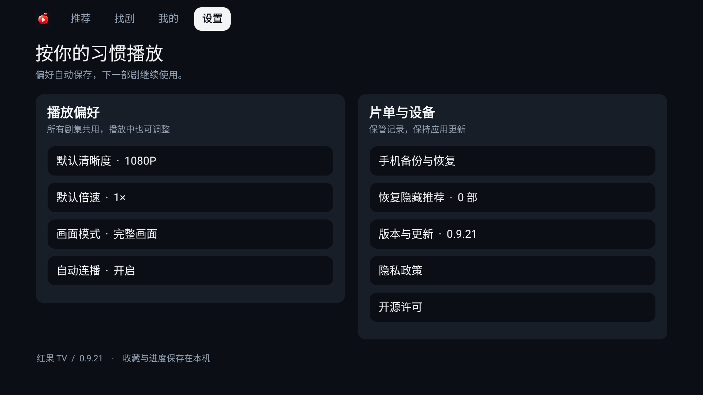

# 红果 TV｜免费无广告的 Android 电视短剧播放器

**免费追短剧，大屏看漫剧。无需登录，无需会员，拿起遥控器就能看。**

红果 TV 是面向 Android 电视、电视盒子的免费短剧客户端，支持真人短剧、漫剧、热门排行榜和全库搜索。下载安装后即可使用，无需注册账号、扫码登录或开通 App 会员。当前公开版本已关闭广告和打赏入口，让大屏回到故事本身。

**[免费下载电视版 APK](https://tv-admin.curatedlifefinds.com/download)** · [GitHub Releases 备用下载](https://github.com/ljl215186/hongguoTV-updates/releases/latest) · [反馈问题](https://github.com/ljl215186/hongguoTV-updates/issues)

Android 8.0+ · 当前正式版 0.9.21 · 遥控器操作 · 真人剧 / 漫剧 · 自动连播

## 免费、免登录、免会员，打开就能追剧

| 你关心的体验 | 红果 TV 的做法 |
|---|---|
| **免费使用** | 免费下载 APK，App 不设置付费解锁和订阅购买流程。 |
| **无需登录** | 不必注册账号，不用扫码登录，打开即可浏览和播放。 |
| **无需会员** | 不需要购买 App 会员，选中作品即可进入观看。 |
| **无广告干扰** | 当前公开配置关闭广告，不展示开屏、集间广告，也不显示打赏入口。 |
| **操作人性化** | 大字海报、清晰焦点、透明浮层，只用方向键、OK 和返回键就能完成常用操作。 |
| **连贯看剧** | 下一集预加载、自动连播、断点续播，让选剧、播放和继续观看更顺手。 |

## 为电视遥控器设计的四个入口

- **推荐**：全屏有声预览，上下切换作品，OK 看全集；返回可唤出透明导航。
- **找剧**：推荐榜、热播榜、臻果榜、预约榜、新剧榜、热搜榜、追更榜、必看榜、收藏榜，配合真人剧 / 漫剧及题材筛选。
- **我的**：接着看、收藏、稍后看集中管理，观看进度保存在本机。
- **设置**：清晰度、倍速、画面模式、自动连播、备份恢复和应用更新，按自己的习惯调整。

搜索同时查找真人剧和漫剧。支持电视输入法；设备具备系统语音能力时，也可以使用语音输入。

## 界面实拍：从找剧到播放

以下为 **0.9.21 实际运行截图**，点击图片可查看原图。我的页面使用收藏空状态，避免展示个人观看记录。

| 全屏推荐与底部浮窗 | 推荐页的透明导航 |
|---|---|
|  |  |

| 真人剧与漫剧分类筛选 | 全库搜索与麦克风入口 |
|---|---|
|  |  |

| 全屏播放 | 播放进度与遥控器提示 |
|---|---|
|  |  |

| 分组快速选集 | 播放设置浮层 |
|---|---|
|  |  |

| 我的收藏 | 应用设置 |
|---|---|
|  |  |

| 应用内检查更新 | 更多播放操作 |
|---|---|
|  |  |

## 播放顺手，连播更流畅

红果 TV 使用原生界面和播放器，提供下一集预加载、自动连播与断点续播。打开作品后直接观看，控制层按需显示；想调整清晰度、倍速或选集时，再用遥控器唤出浮层。

| 场景 | 遥控器操作 |
|---|---|
| 顶部栏目 | ← / → 移动即切换页面，OK 或 ↓ 进入内容。 |
| 推荐内容 | ↑ / ↓ 切换推荐，OK 看全集，→ 打开底部操作，返回唤出导航。 |
| 正剧播放 | OK 暂停 / 播放，← / → 快退 / 快进，↓ 选集，↑ 更多操作。 |
| 菜单与浮层 | 返回逐层收起，再回到来源页面。 |

流畅度会受电视性能、家庭网络和内容源状态影响。若遇到缓冲，可降低清晰度、检查 Wi-Fi 或重试播放。

## 免费下载与安装 Android TV APK

1. 打开 **[红果 TV 下载页](https://tv-admin.curatedlifefinds.com/download)**，下载带版本号的正式 APK；也可从 [GitHub Releases](https://github.com/ljl215186/hongguoTV-updates/releases/latest) 下载。
2. 通过 U 盘、局域网传输或电视自带的文件工具，将 APK 传入电视 / 盒子。
3. 在系统安装器确认安装；首次安装可能需要允许对应工具安装未知来源应用。
4. 打开红果 TV，无需登录或购买会员，进入推荐或找剧即可开始观看。

最低 Android 8.0，适用于允许运行 Android APK 的电视和电视盒子。其他系统是否兼容，请以设备实际支持为准。

## 常见问题

### 红果 TV 真的免费吗？需要登录或会员吗？

App 免费提供，不设置账号注册、会员购买和付费解锁流程。收藏及观看进度存放在本机；作品是否可播放取决于内容源的实际状态。

### 红果 TV 有广告或打赏弹窗吗？

当前公开配置已关闭广告展示、广告开关入口和打赏栏目，观看时无需通过广告解锁下一集。截图展示的也是该配置下的实际界面。

### 支持短剧、漫剧和全库搜索吗？

支持真人短剧与漫剧，可通过排行榜、分类筛选或关键词查找。漫剧还可按画风筛选。搜索不受当前榜单类型限制。

### 可以在应用内更新吗？

可以从 **设置 → 版本与更新** 检查、下载新版，再由 Android 系统确认安装。也会在前台空闲时检查更新；播放中不打扰。关闭自动下载仍可收到升级提示。

部分 Android 9 设备使用 0.9.19 及更早测试版时，可能误报安装包签名不匹配。请下载 0.9.21 或更新版本，通过系统文件管理器覆盖安装；包名一致时保留本机记录。

### 旧版本如何保留收藏和观看进度？

正式包名为 `com.ljl215186.hongguotv`。如果旧包名不同，可先在旧版 **设置 → 手机备份与恢复** 导出 JSON，再安装新包、导入并核对记录。新旧应用可并存，确认恢复前保留旧应用。之后同包名、同签名的正式版可覆盖升级。

### 是红果官方电视版吗？

这是独立维护的非官方电视客户端，与红果官方无关联。反馈问题时请附版本、设备型号、Android 版本与复现步骤，请勿公开口令或私人记录。

## 下载校验与项目说明

正式包签名 SHA-256：`ec06e0a3b354c0316f0e8d526619565f56d7a31109e6bfc4317b89b584041c81`。每个版本的 APK 校验和见 Release 附件 `SHA256SUMS`。

此仓库提供正式安装包、使用说明和界面截图。第三方组件许可与署名见 [第三方声明](NOTICE.md)。

**[立即免费下载红果 TV](https://tv-admin.curatedlifefinds.com/download)** · [查看版本更新](https://github.com/ljl215186/hongguoTV-updates/releases) · [提交使用反馈](https://github.com/ljl215186/hongguoTV-updates/issues)
