# 红果 TV｜免费、免登录、免会员的 Android 电视短剧播放器

**免费追短剧，大屏看漫剧。无需登录，无需会员，拿起遥控器就能看。**

红果 TV 是面向 Android 电视、电视盒子的免费短剧客户端，支持真人短剧、漫剧、热门排行榜和全库搜索。下载安装后即可使用，无需注册账号、扫码登录或开通 App 会员。大字海报、清晰焦点与全屏播放，让大屏回到故事本身。

**[免费下载电视版 APK](https://hongguotv-egb.pages.dev/)** · [GitHub Releases 备用下载](https://github.com/ljl215186/hongguoTV-updates/releases/latest) · [反馈问题](https://github.com/ljl215186/hongguoTV-updates/issues)

Android 8.0+ · 当前正式版 0.9.28 · 遥控器操作 · 真人剧 / 漫剧

0.9.28 将播放进度线左右端点与文字及操作区对齐，保留完整的 App 图标滑块。从正剧返回推荐自动显示顶部导航，切换栏目时导航文字位置统一。继续支持全库搜索分页和末页提示。下方截图来自 0.9.23 的实际运行，仅供界面参考；新版按键以本文操作表为准，本次未进行设备或模拟器验收。

**安装导航：** [支持的电视品牌](#支持哪些电视品牌和电视盒子) · [U 盘安装图解](INSTALL.md#usb-install) · [手机 / 电脑无线安装](WIRELESS-INSTALL.md) · [按品牌查看安装教程](INSTALL.md#brand-guides) · [安装失败排查](INSTALL.md#troubleshooting)

本项目仅供个人研究、学习与技术交流，为非官方客户端；第三方作品和标识归相应权利人所有。请在合法授权范围内使用，“仅供学习研究”不表示取得内容授权。详见 [免责声明](DISCLAIMER.md)。

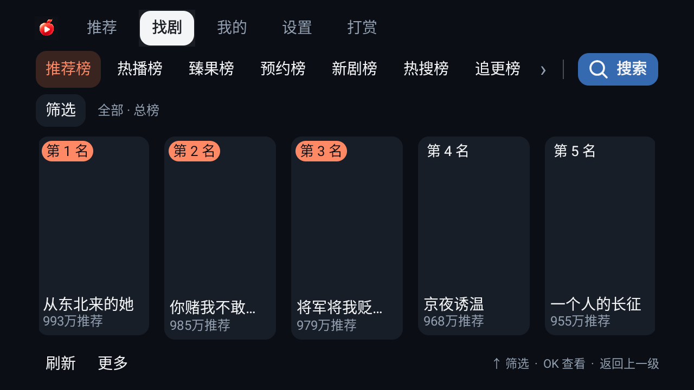

## 免费、免登录、免会员，打开就能追剧

| 你关心的体验 | 红果 TV 的做法 |
|---|---|
| **免费使用** | 免费下载 APK，App 不设置付费解锁和订阅购买流程。 |
| **无需登录** | 不必注册账号，不用扫码登录，打开即可浏览和播放。 |
| **无需会员** | 不需要购买 App 会员，选中作品即可进入观看。 |
| **专注大屏观看** | 全屏播放，控制层按需出现，常用操作通过透明浮层完成。 |
| **操作人性化** | 大字海报、清晰焦点、透明浮层，只用方向键、OK 和返回键就能完成常用操作。 |
| **连贯看剧** | 下一集预加载、自动连播、断点续播，让选剧、播放和继续观看更顺手。 |

## 为电视遥控器设计的四个入口

- **推荐**：全屏有声预览，上下切换作品，OK 看全集；返回可唤出透明导航。
- **找剧**：推荐榜、热播榜、臻果榜、预约榜、新剧榜、热搜榜、追更榜、必看榜、收藏榜，配合真人剧 / 漫剧及题材筛选。
- **我的**：接着看、收藏、稍后看集中管理，观看进度保存在本机。
- **设置**：清晰度、倍速、画面模式、自动连播、备份恢复和应用更新，按自己的习惯调整。

搜索同时查找真人剧和漫剧，支持通过下方“上一页 / 下一页”继续浏览，跨页排除重复作品。到达末页会提示并留在当前页，加载失败也不会跳到空白页。支持电视输入法；设备具备系统语音能力时，也可以使用语音输入。

## 界面实拍：从找剧到播放

以下 **12 张截图来自 0.9.23 的实际运行**，展示推荐、找剧、搜索、播放、选集与收藏。主要截图为 1080p，大字体示例为 720p；片单和观看记录来自当时的测试。

| 全屏推荐与底部浮窗 | 推荐页的透明导航 |
|---|---|
| 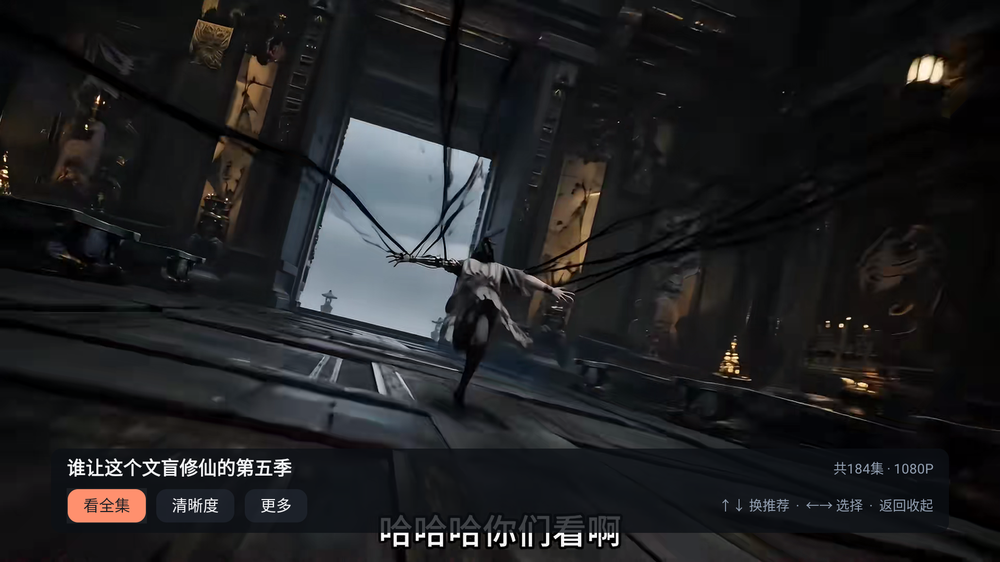 | 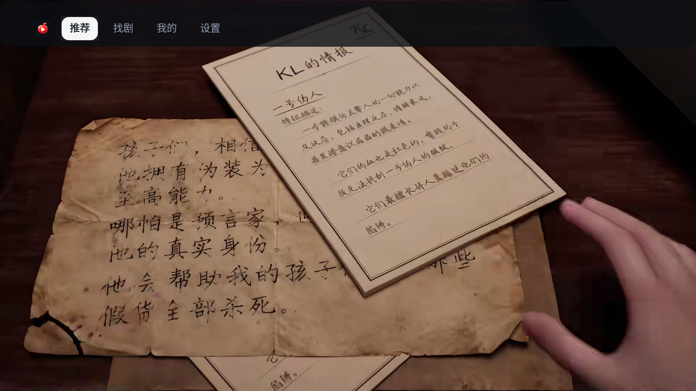 |

| 真人剧与漫剧分类筛选 | 全库搜索与麦克风入口 |
|---|---|
| 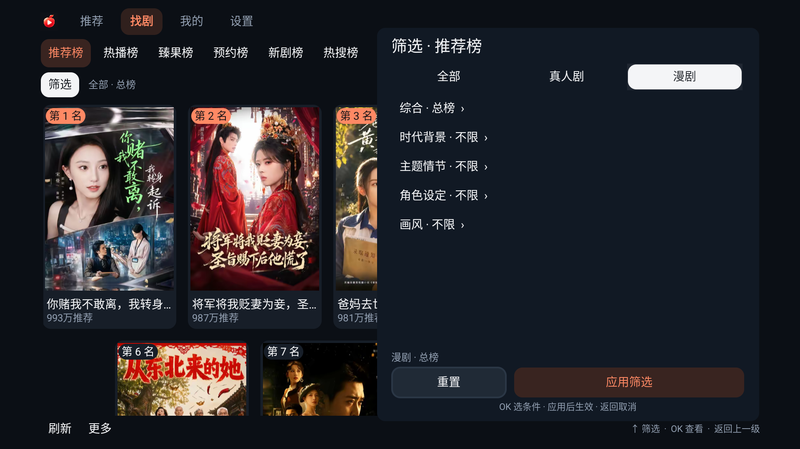 | 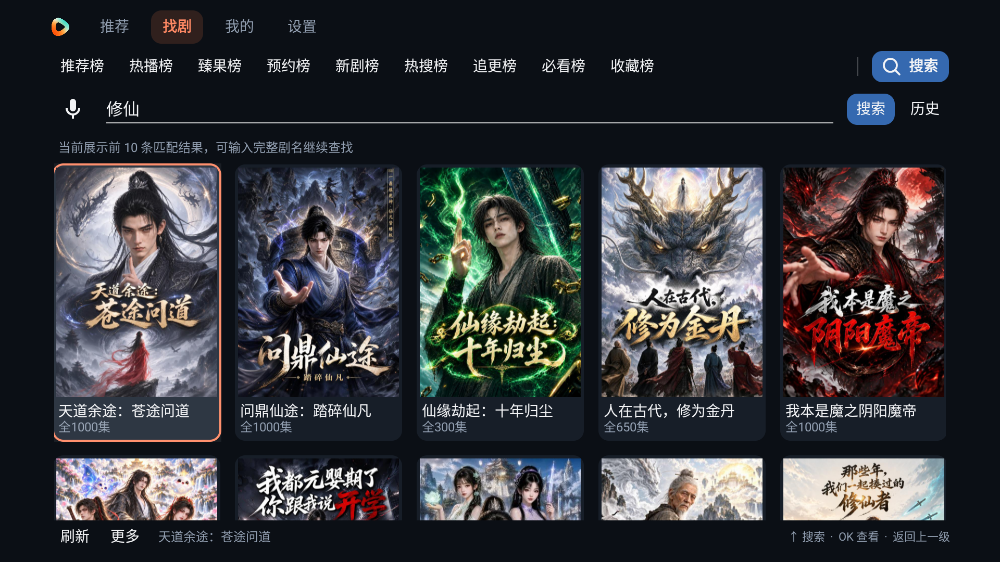 |

| 全屏播放 | 播放进度与遥控器提示 |
|---|---|
|  | 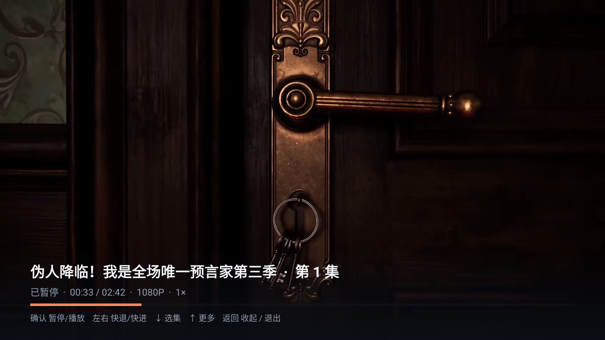 |

| 分组快速选集 | 播放设置浮层 |
|---|---|
| 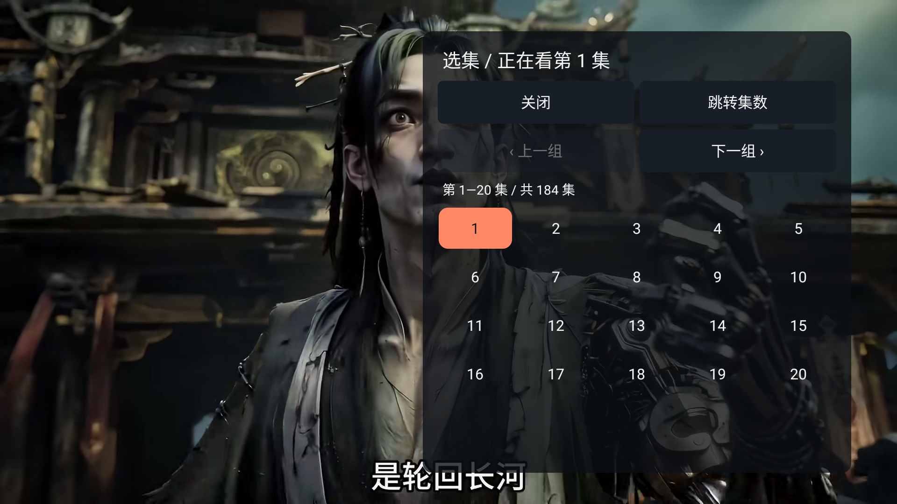 | 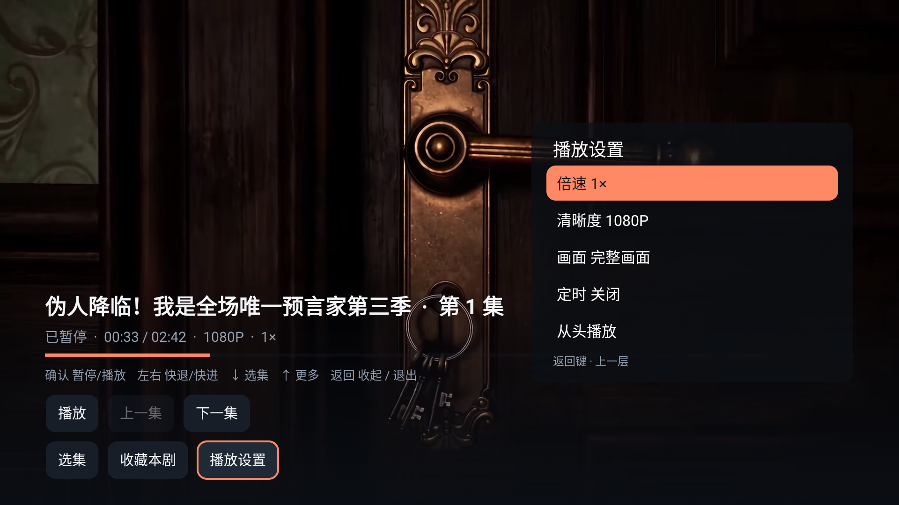 |

| 接着看与收藏状态 | 更多播放操作 |
|---|---|
| 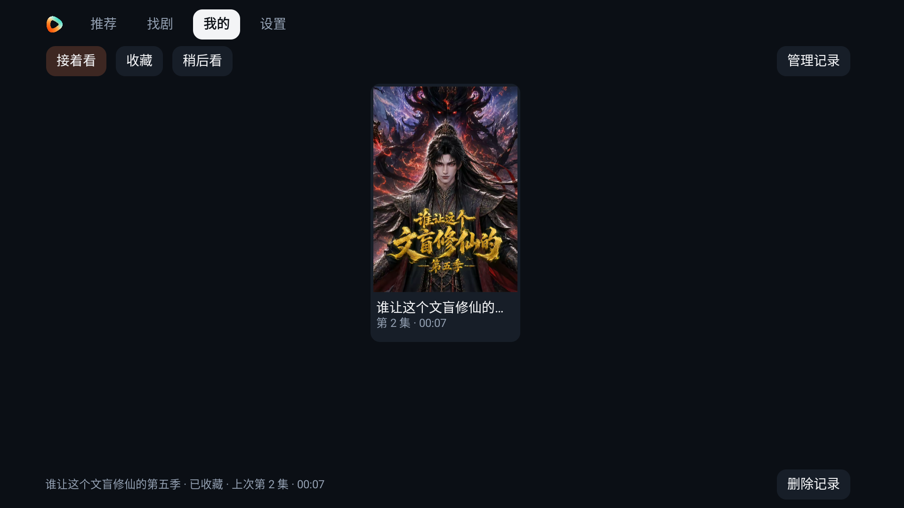 | 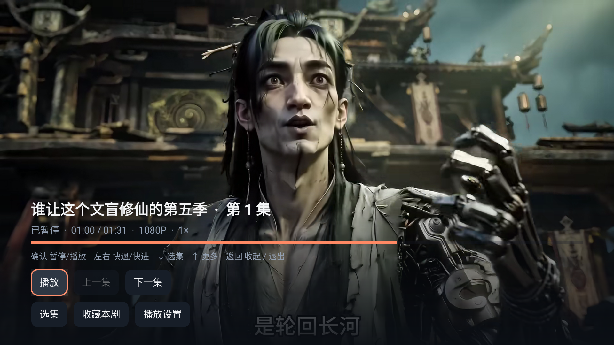 |

### 大字体自动切换四列海报

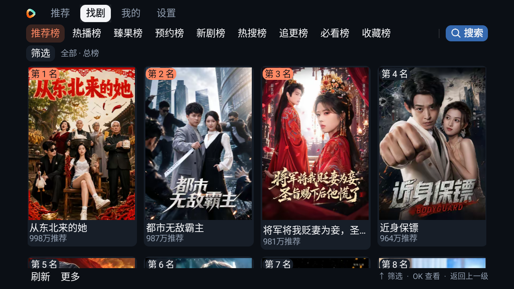

0.9.23 已在指定的 Android 9 / x86_64 测试环境重新安装并检查，覆盖 1080p、720p 和 1.3 倍字体；核心测试 187 项、后台测试 24 项通过。实际完成了推荐切换、漫剧播放、暂停快进、选集、收藏、全库搜索和版本检查；这些结果不代表每个品牌电视均已实机验收，真实电视语音能力仍需按设备确认。

## 播放顺手，连播更流畅

红果 TV 使用原生界面和播放器，提供下一集预加载、自动连播与断点续播。打开作品后直接观看，控制层按需显示；想调整清晰度、倍速或选集时，再用遥控器唤出浮层。

| 场景 | 遥控器操作 |
|---|---|
| 顶部栏目 | ← / → 移动即切换页面，OK 或 ↓ 进入内容。 |
| 推荐全屏观看 | ↑ / ↓ 上一部 / 下一部推荐，OK 看全集；← / → 或菜单键显示底部控制层。 |
| 正剧全屏观看 | ↑ / ↓ 本剧上一集 / 下一集，OK 暂停 / 继续；← / → 或菜单键显示底部控制层。 |
| 播放控制层 | 首次左右只显示，不改变进度。App 图标滑块放大表示进度条聚焦，此时左右快退 / 快进，上下选择操作；按钮上左右移动焦点、OK 执行。 |
| 菜单与浮层 | 在菜单内方向键只操作当前菜单。返回依次收起子菜单、控制层，再返回来源页面；从正剧回到推荐时自动显示顶部透明导航并聚焦“推荐”。 |
| 搜索与榜单分页 | 选择“上一页 / 下一页”并按 OK；翻页后焦点保留在原按钮，末页继续点击只提示，不空翻页。 |

流畅度会受电视性能、家庭网络和内容源状态影响。若遇到缓冲，可降低清晰度、检查 Wi-Fi 或重试播放。

## 支持哪些电视品牌和电视盒子

适用于 **Android 8.0（API 26）及以上、允许安装本地 APK** 的电视和电视盒子。可按下表查找小米、海信、TCL、创维等品牌的安装方法；品牌名称不等于全系兼容，具体还取决于型号、地区、系统版本与安装权限。

| 电视品牌 / 设备 | 适用范围与安装教程 |
|---|---|
| **小米 / Redmi 电视、小米盒子** | 符合系统要求的机型，可通过电视管家或高清播放器安装。[查看教程](INSTALL.md#xiaomi) |
| **海信 / Vidda** | 仅适用于符合要求且允许 APK 安装的 Android 机型；VIDAA / Roku 系统不适用。[查看教程](INSTALL.md#hisense) |
| **TCL / 雷鸟** | Android / Google TV 或兼容 Android APK 的机型；TCL 海外说明不能直接套用全部国内固件。[查看教程](INSTALL.md#tcl) |
| **创维 / 酷开** | 需确认 Android 版本及本地安装权限；部分固件限制第三方安装。[查看教程](INSTALL.md#skyworth) |
| **长虹 / CHiQ** | 符合要求的 Android 机型，按本机文件工具与安装器操作。[查看教程](INSTALL.md#changhong) |
| **康佳** | 符合要求且开放本地 APK 安装的 Android 机型。[查看教程](INSTALL.md#konka) |
| **海尔 / 卡萨帝** | 需核对具体型号的系统版本、USB 文件浏览和安装权限。[查看教程](INSTALL.md#haier) |
| **索尼 BRAVIA** | Android TV / Google TV 机型；非 Android 老机型不适用。[查看教程](INSTALL.md#sony) |
| **飞利浦 / 夏普** | 仅适用于符合要求的 Android TV / Google TV 机型。[查看教程](INSTALL.md#philips-sharp) |
| **荣耀智慧屏 / 华为智慧屏** | 部分型号提供第三方安装入口，但本 App 兼容性仍需核验，暂不列为已验证支持。[查看说明](INSTALL.md#smart-screen) |
| **其他 Android 电视盒子 / 投影仪** | 符合 Android 8.0+、APK 安装及遥控器要求时可尝试。[查看教程](INSTALL.md#android-box) |

上述为**安装条件与教程索引，不是逐品牌实机认证名单**。目前完成 Android 9 指定测试设备验证，尚未完成这些品牌全部机型的实机验收。三星 Tizen、LG webOS、VIDAA、Roku、Titan OS 等非 Android 系统不能直接运行本 APK，可在外接兼容 Android 盒子上安装。系统差异与厂商来源见 [完整安装指南](INSTALL.md#compatibility)。

## 免费下载与安装 Android TV APK

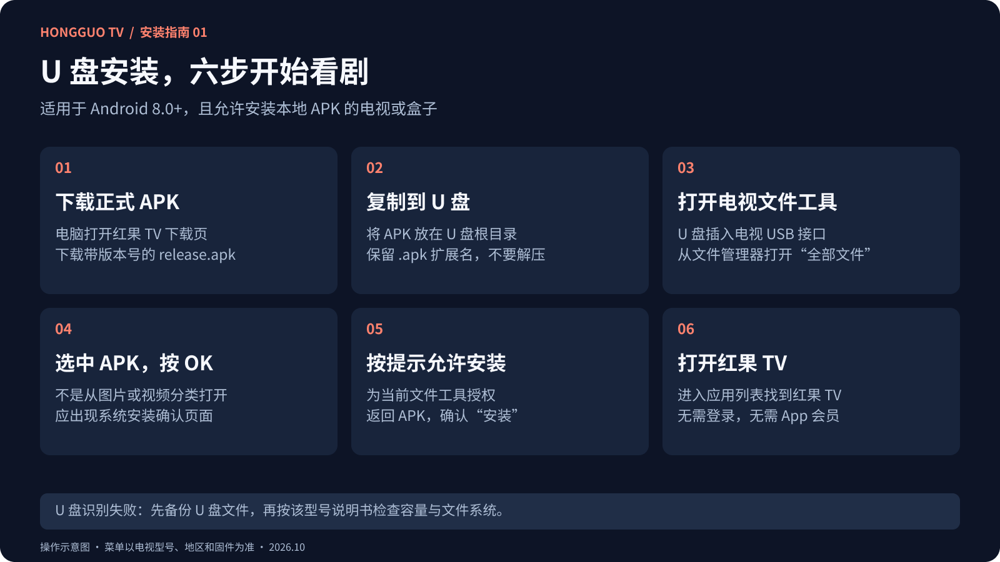

上图为操作示意，不是各品牌系统实拍。详细步骤与官方说明见 **[安卓电视安装图文教程](INSTALL.md)**。

**没有 U 盘也能安装：** 电视自带传文件、品牌手机助手、当贝远程安装、Send Files to TV、电视直接下载等方法，见 [无线安装图文教程](WIRELESS-INSTALL.md)。iPhone 用户可优先查看 [浏览器上传方案](WIRELESS-INSTALL.md#iphone)；普通镜像 / 视频投屏不等于传 APK 安装。

1. 打开 **[红果 TV 下载页](https://hongguotv-egb.pages.dev/)**，下载带版本号的正式 APK；也可从 [GitHub Releases](https://github.com/ljl215186/hongguoTV-updates/releases/latest) 下载。
2. 将 APK 放入 U 盘根目录，插入电视 / 盒子 USB 接口；没有 USB 接口时，可使用设备支持的局域网文件传输工具。
3. 使用支持 APK 的文件工具打开安装包，在系统安装器确认安装；首次安装按提示允许**当前文件工具**安装未知来源应用。
4. 打开红果 TV，无需登录或购买会员，进入推荐或找剧即可开始观看。

文件名示例：`hongguotv-0.9.28-release.apk`。下载 Release 的 APK 附件，不下载 `Source code (zip)` 或 `Source code (tar.gz)`；APK 不需要解压。首次下载直接安装，安装后可在 **设置 → 版本与更新** 获取后续同包名正式版。

## 常见问题

### 红果 TV 真的免费吗？需要登录或会员吗？

App 免费提供，不设置账号注册、会员购买和付费解锁流程。收藏及观看进度存放在本机；作品是否可播放取决于内容源的实际状态。

### 支持短剧、漫剧和全库搜索吗？

支持真人短剧与漫剧，可通过排行榜、分类筛选或关键词查找。漫剧还可按画风筛选。搜索不受当前榜单类型限制。

### 可以在应用内更新吗？

可以从 **设置 → 版本与更新** 检查、下载新版，再由 Android 系统确认安装。也会在前台空闲时检查更新；播放中不打扰。关闭自动下载仍可收到升级提示。

### 收藏和观看进度如何保存？

正式包名为 `com.hongguo.tv`。收藏、观看进度与设置保存在本应用的独立目录，不需要账号。以后同包名、同正式签名的版本可覆盖升级并保留记录；需要换设备时，可在 **设置 → 手机备份与恢复** 导出和导入 JSON。

### 如何反馈使用问题？

请通过本仓库 Issues 反馈，并附版本、设备型号、Android 版本与复现步骤，请勿公开口令或私人记录。

## 项目说明

此仓库提供红果 TV 正式安装包、版本更新、使用说明和界面截图。

**[立即免费下载红果 TV](https://hongguotv-egb.pages.dev/)** · [查看版本更新](https://github.com/ljl215186/hongguoTV-updates/releases) · [提交使用反馈](https://github.com/ljl215186/hongguoTV-updates/issues)
