# 红果TV 新版功能截图 / Screenshot Gallery

[返回简体中文介绍](README.md) · [繁體中文](README.zh-TW.md) · [English](README.en.md)

2026-10-24 在 121 Android 9 测试设备上重新采集，使用 1920×1080 横屏画布。主要界面来自 0.9.73，最终设置、备份与更新页面来自 0.9.74；两版共用本轮修复的弹幕布局。以下均为实际画面，没有注入示例账号、评论或片单。点击图片可查看原图。

## 推荐与找剧 / Discover

| 透明推荐导航 | 推荐播放控制 |
|---|---|
|  |  |

| 排行榜 | 热播榜 |
|---|---|
|  |  |

| 漫剧排行榜 | 漫剧筛选 |
|---|---|
|  |  |

| 分类筛选 | 全库搜索 |
|---|---|
|  |  |

| 搜索分页按钮 | 下一页结果 |
|---|---|
|  |  |

## 详情、播放与评论 / Playback

| 剧集详情 | 分组切换与焦点保持 |
|---|---|
|  |  |

| 全屏播放 | 播放控制与互动数量 |
|---|---|
|  | 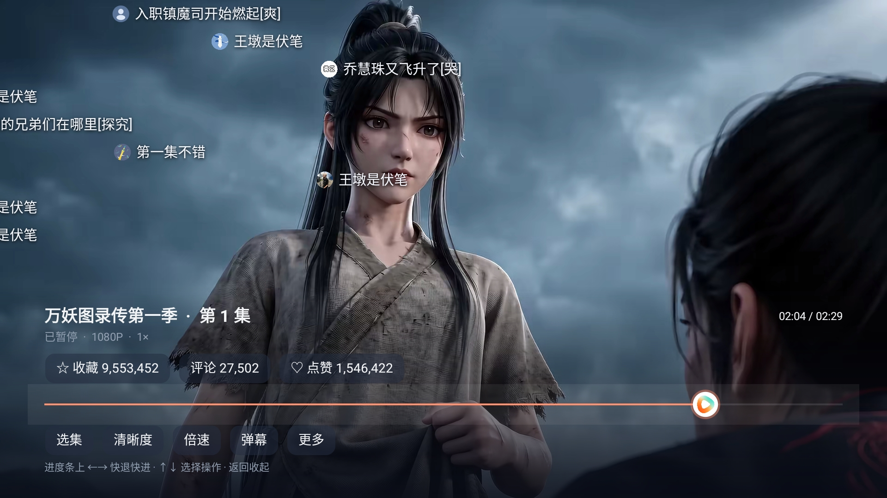 |

| 评论列表 | 向下浏览更多评论 |
|---|---|
| 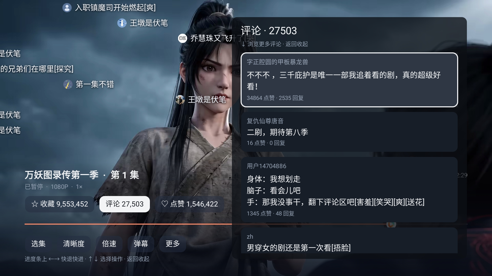 | 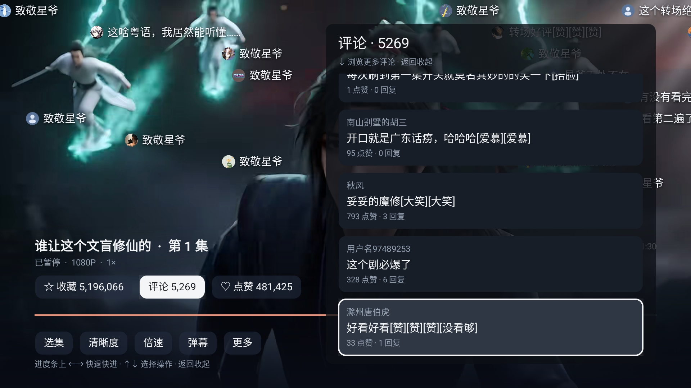 |

| 播放中选集 | 清晰度 |
|---|---|
| 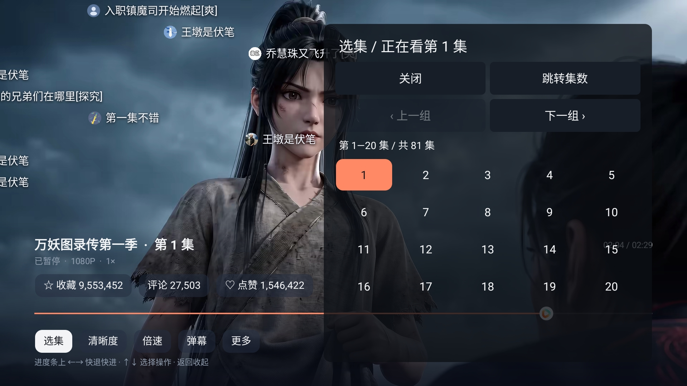 | 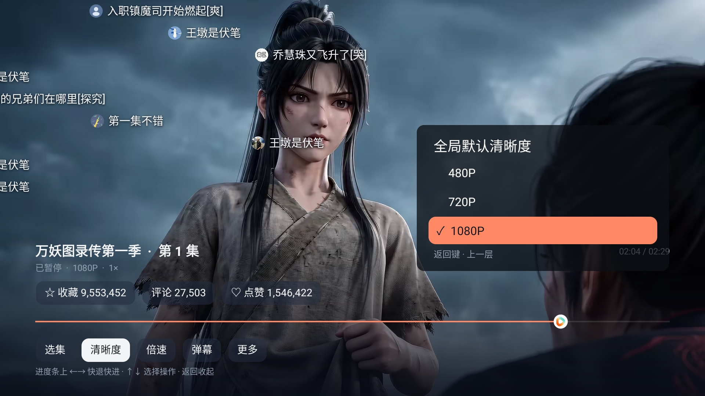 |

| 播放倍速 | 更多播放设置 |
|---|---|
| 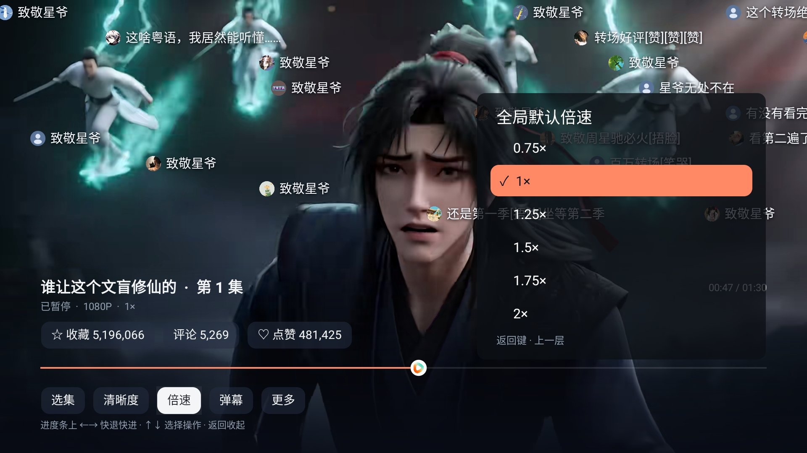 | 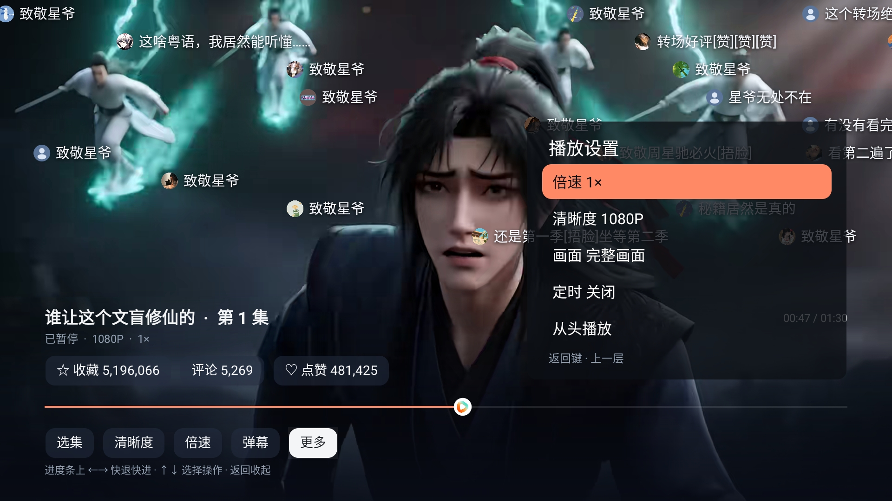 |

| 画面模式 | 定时停止 |
|---|---|
| 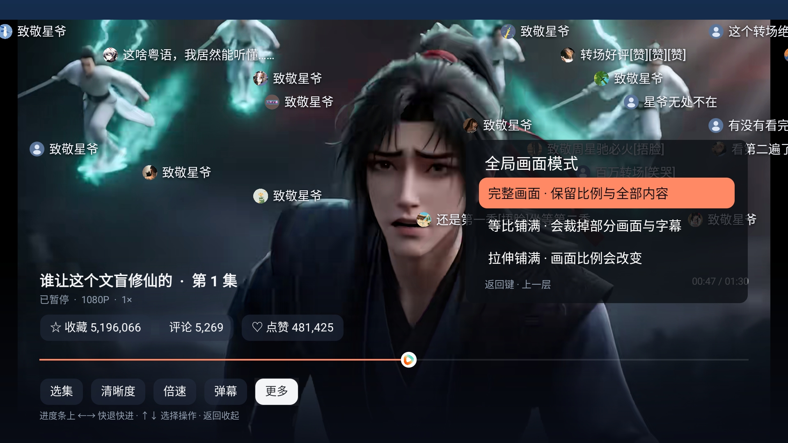 | 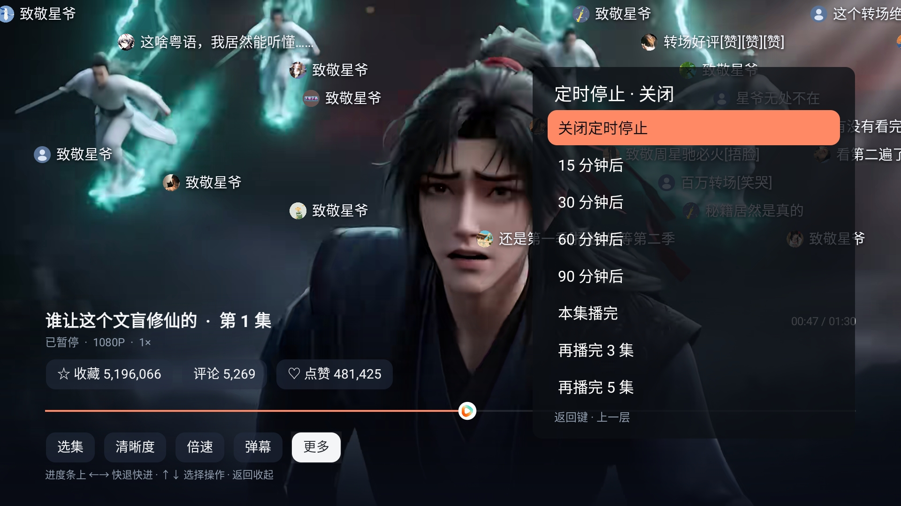 |

## 弹幕范围与设置 / On-screen Messages

全屏和半屏两张图来自同一集、同一播放位置：全屏的上下区域都可显示，半屏只使用上半屏。每条弹幕左侧显示圆形头像，暂时无可用头像时使用默认图。

| 全屏 | 半屏 |
|---|---|
| 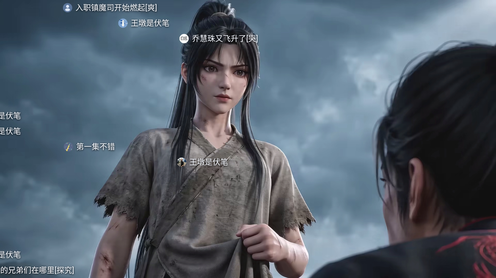 | 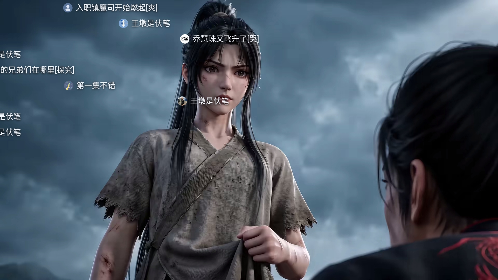 |

| 四项设置 | 显示范围 |
|---|---|
| 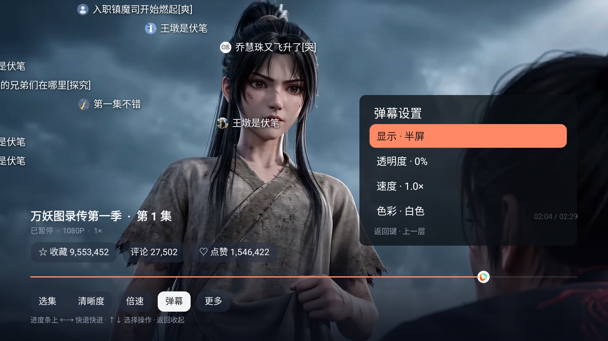 | 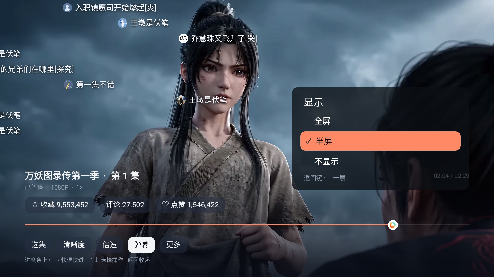 |

| 透明度 | 弹幕速度 |
|---|---|
| 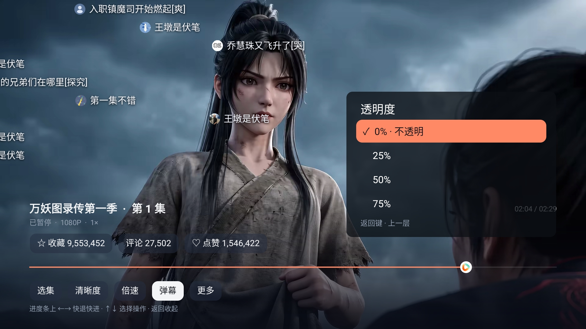 | 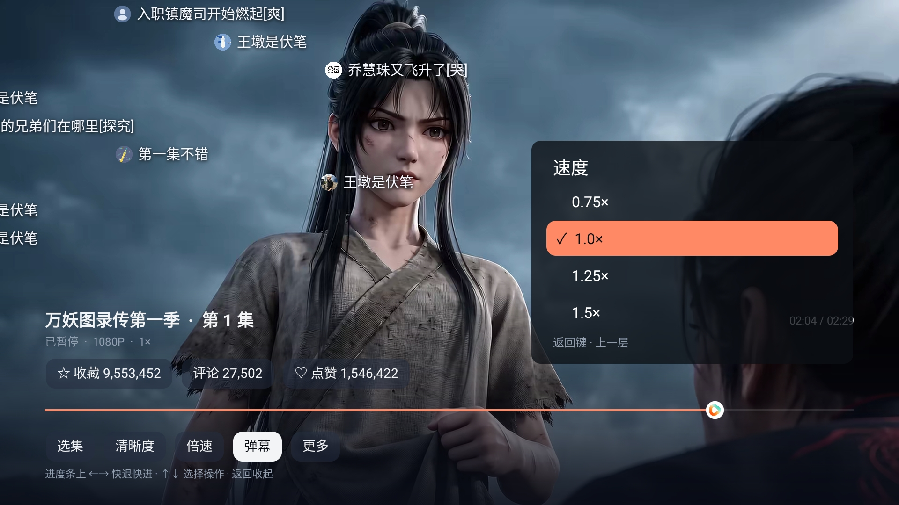 |

| 色彩 | 关闭弹幕 |
|---|---|
| 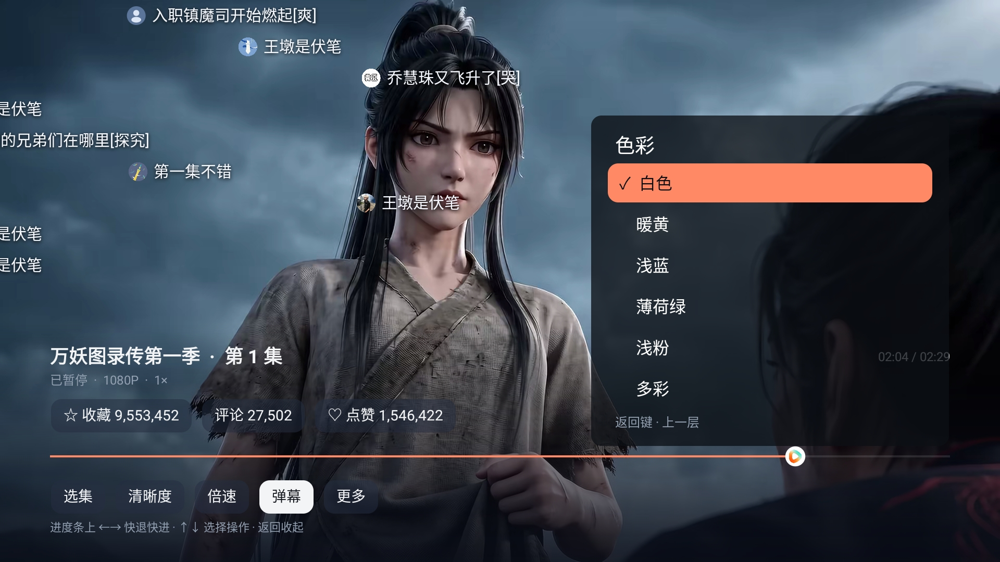 |  |

## 我的与可选登录 / Library and Login

| 接着看 | 收藏 |
|---|---|
|  |  |

| 稍后看 | 手机号登录 |
|---|---|
|  | 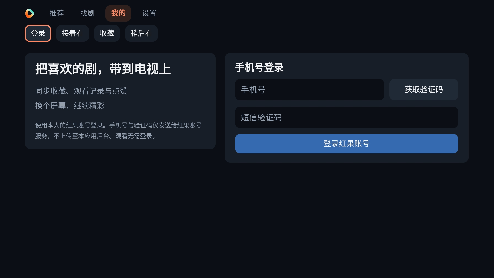 |

当前 App 为游客状态，因此没有用示例账号展示已登录资料或点赞片单。本次未发送短信、未执行账号收藏或点赞回写；账号服务可用性与真实登录需本人完成验证，游客观看不受影响。

## 设置、语言、备份与更新 / Settings

| 应用设置 | 三种语言 |
|---|---|
| 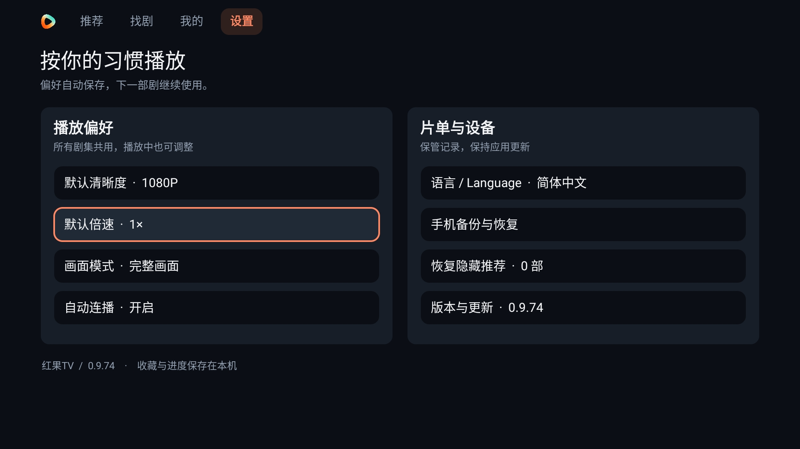 |  |

| English | 繁體中文 |
|---|---|
|  |  |

| 手机备份与恢复 | 版本与更新 |
|---|---|
|  |  |

备份截图中的临时地址和二维码已关闭，无法用于下载记录；实际操作请在本人设备重新打开页面。图片仅展示界面，本轮没有导入或覆盖任何片单。

## 测试范围

上述为指定 Android 9 测试设备的实际界面，不能视为海信等所有品牌电视的实机验收。搜索和版本检查各有过一次请求失败，重试后恢复；截图使用真实成功结果，不代表网络或内容源始终可用。测试结束后恢复设备原始分辨率及简体中文，未卸载或清除数据。
