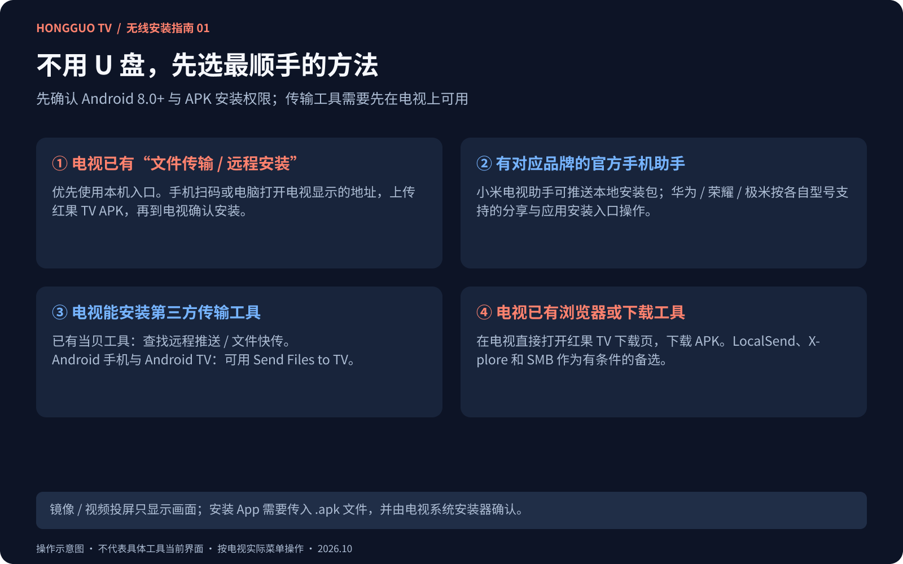
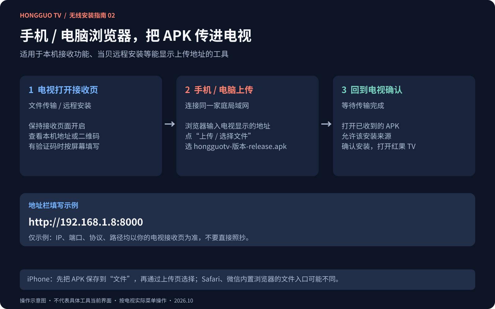
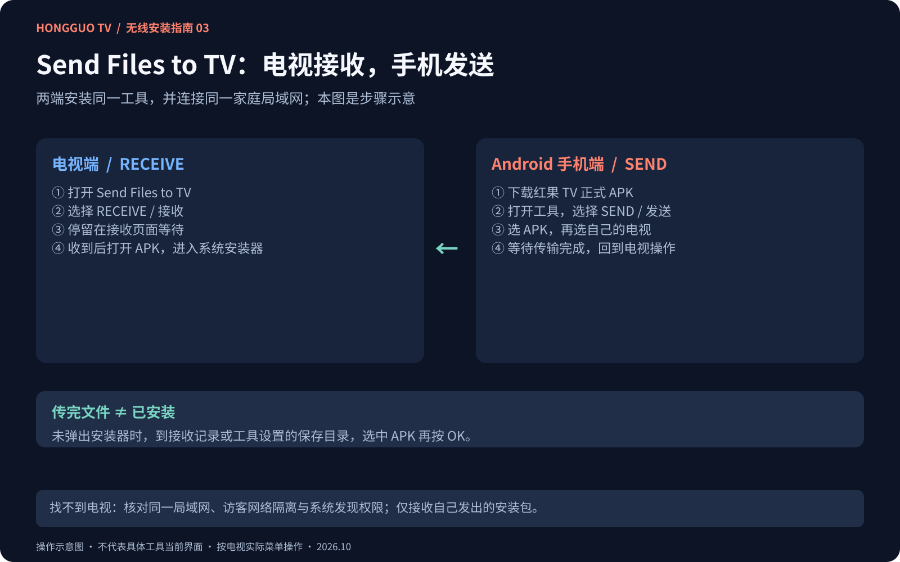

# 红果 TV 无线安装图文教程｜手机传 APK、电脑远程安装与文件快传

没有 U 盘，也可以通过电视自带文件传输、品牌手机助手或第三方传输工具安装红果 TV。本页按你已经具备的设备和功能选择方法，适用于**允许安装 APK 的 Android 8.0+ 电视、盒子及投影仪**。

[下载正式 APK](https://hongguotv-egb.pages.dev/) · [电视品牌与 U 盘教程](INSTALL.md) · [功能与界面截图](README.md) · [免责声明](DISCLAIMER.md)

资料核对日期：**2026-10-20**。配图为 Figma 制作的操作示意，不是某品牌或工具的实测截图。各工具的系统、地区、收费和权限要求以开发者当前说明为准；本文不表示已在每款电视完成验收。

## 先选方法：你现在有什么条件

| 现有条件 | 优先方法 | 手机 / 电脑还需要什么 |
|---|---|---|
| 电视有“文件传输 / 文件快传 / 远程安装” | [电视接收页 + 浏览器上传](#builtin-transfer) | 通常只需浏览器；按电视显示的地址或二维码进入。 |
| 小米电视 / 盒子，且支持官方助手安装包推送 | [小米电视助手](#brand-apps) | Android 手机安装官方助手。 |
| 华为 / 荣耀智慧屏或极米投影，具备对应分享入口 | [品牌官方分享或助手](#brand-apps) | 对应手机、App 与型号兼容条件。 |
| 电视已有当贝市场、电视应用管家等工具 | [当贝远程推送 / 远程安装](#dangbei) | 手机或电脑浏览器；不必另装手机端传输 App。 |
| Android 手机和电视均能安装传输工具 | [Send Files to TV](#sfttv) | 两端安装同一工具，电视接收、手机发送。 |
| 电视已有可下载 APK 的浏览器 / 下载工具 | [直接下载 / Downloader](#direct-download) | 无需先在手机或电脑下载。 |
| iPhone / 电脑与电视均可使用 LocalSend | [LocalSend 备选](#localsend) | 两端安装工具，并确认电视端能操作。 |
| 电视已有 X-plore 或可访问局域网共享的文件管理器 | [网页上传 / SMB 共享](#file-manager) | 浏览器，或现有电脑 / NAS 文件共享。 |

**普通投屏不等于安装应用。** 镜像、AirPlay、Miracast、DLNA 或“照片 / 视频投屏”主要用于显示画面或播放媒体。只有工具明确提供 **APK / 安装包 / 文件传输 / 应用安装** 能力时，才把它用于本教程。传输完成后还要由电视系统安装器确认；传输工具不能解除固件限制，也不能让非 Android 系统运行本 APK。

## 开始前准备

1. 手机 / 电脑打开 [红果 TV 下载页](https://hongguotv-egb.pages.dev/)，下载 `hongguotv-0.9.37-release.apk` 或页面列出的更新版本，不下载 Source code 压缩包，不解压 APK。
2. 确认电视与发送设备能在同一个家庭局域网通信。电视接网线、手机接 Wi-Fi 也可以，但不能被访客网络或设备隔离阻断；不要求一定同为 2.4 GHz 或 5 GHz。
3. **第三方互传工具必须先在电视上可用。** 可从设备允许的应用商店安装，或先通过品牌官方助手、浏览器、U 盘装好工具。不能只在手机安装工具，就让没有接收端的电视凭空收到 APK。
4. 使用你自己电视显示的接收地址、验证码与保存目录。图中 IP 和端口只是示例；传完后关闭接收 / 共享功能。

## 方法一：电视自带文件传输 / 文件投屏

适合：已经有文件接收入口，且明确支持安装包的电视或投影仪。不同厂商可能称为“文件快传”“远程安装”“传文件”“文件投屏”，菜单位置不统一。

1. 在电视的应用、文件工具或官方助手中，打开 **文件传输 / 接收文件 / 远程安装**，核对支持的文件类型包含 APK 或安装包。
2. 保持电视接收页面开启，查看它提供的**局域网地址、二维码、配对码或验证码**。
3. **手机：** 扫描接收页二维码，或在浏览器地址栏输入电视显示的完整地址。**电脑：** 打开浏览器，在地址栏输入同一个地址，保留 `http://` 或 `https://`、端口和路径。
4. 点击接收页中的“上传 / 选择文件 / 添加文件”，选择已下载的红果 TV APK；需要验证码时按电视提示输入。
5. 等进度完成，回到电视的接收记录或保存目录，选中 APK，按 **OK / 确认**。系统要求时，允许当前文件工具安装应用，再返回确认安装。
6. 从电视应用列表打开红果 TV。若工具只是把手机画面投到电视，没有出现 APK 文件或系统安装器，请改用其他方法。

这类流程的厂商实例可参考 [当贝官方文件快传图文教程](https://club.dangbei.com/52.html) 和下方品牌助手说明。旧教程中的入口只能用于仍保留该功能的版本；以你当前设备显示为准。

## 方法二：品牌官方手机助手与分享功能

### 小米 / Redmi / 小米盒子：小米电视助手

1. 在 Android 手机安装官方 **小米电视助手**，与电视 / 盒子接入同一局域网。
2. 使用助手的扫码、附近设备或 IP 连接功能，按电视提示配对。
3. 在支持此功能的版本中打开 **本地应用 / 本地安装包 / 应用管理**，选择红果 TV APK，发起安装包推送。
4. 手机文件没被列出时，先把 APK 下载到手机系统可访问的目录，再给助手所需的文件访问权限。
5. 回到电视按提示确认安装；不需要在手机上先安装红果 TV 本身。

小米官方说明区分了本地应用安装与屏幕镜像，并注明该手册的助手**仅支持 Android 手机**。不要把“投照片 / 视频”当作本地 APK 推送入口。[小米官方助手使用手册](https://cdn.cnbj1.fds.api.mi-img.com/ics-resources/articles/6486cea917f0c70645b252ab.html)、[官方安装包推送说明](https://privacy.mi.com/xiaomitvassistant/zh_CN/)

### 华为智慧屏：智慧生活 App / Huawei Share

先核对智慧屏支持 Android APK 兼容安装；本项目仍未完成这些机型验收。

- **智慧生活 App：** 根据厂商说明，在同一 WLAN 连接并绑定智慧屏，打开设备卡片中的 **应用 → 本地应用安装包**，选择 APK 后发送，在智慧屏完成安装确认。该官方方法不支持 iPhone 上的智慧生活，也不能用来给荣耀智慧屏安装应用。
- **Huawei Share：** 使用支持的华为手机 / 平板及智慧屏，在手机文件管理中选中 APK，通过 **分享 → Huawei Share** 发送；在电视端确认接收并打开安装包。具体配对、开关和适用机型以官方页面为准。

[华为官方第三方应用安装图文说明](https://consumer.huawei.com/cn/support/content/zh-cn01089258/)

### 荣耀智慧屏：荣耀分享

1. 在支持的荣耀手机 / 平板下载 APK，打开 **荣耀分享**。
2. 在下载管理中选中 APK，点击 **分享**，选择自己的智慧屏，按提示接收。
3. 在智慧屏进入 **媒体中心 → 本地 → 荣耀分享**，选中安装包并确认安装。

荣耀官方明确注明 **智慧屏 X3i 系列不支持此分享操作**。能传输文件也不等于本 App 已适配该机型，先核对兼容要求。[荣耀官方图文教程](https://www.honor.com/cn/support/content/zh-cn15812201/)

### 极米投影：极米 App

在具备相应入口的型号上，手机与投影接入同一 Wi-Fi，打开极米 App 添加设备，按投影显示的验证码配对；进入 **爱机 / 工具 → 传文件 / 应用安装**，选择已保存的 APK，发送后在投影端确认。入口名称和支持的文件类型随型号、App 版本变化。

极米开发者的 App Store 页面列有文件传输、应用安装能力；当贝针对极米的图文教程给出了 **爱机 → 快捷工具 → 传文件 → 文档 / APK** 示例。该示例原本安装的是当贝自己的软件，这里只参考其文件传输步骤，不要求先装当贝市场，也不保证全部型号接受任意 APK。[极米官方 App 介绍](https://apps.apple.com/cn/app/id956166148)、[当贝发布的极米传文件图文示例](https://www.dangbei.com/jimi.html)

## 方法三：当贝市场 / 电视应用管家远程安装

适合：电视已经安装这些工具，或能从电视商店安装。普通 Android 电视不需要为传一次文件而更换默认桌面。

1. 打开电视上的 **当贝市场**，查找当前版本的 **远程推送**；或打开 **电视应用管家 → 远程安装**。
2. 进入功能后，按电视显示的地址或二维码，在同一局域网的手机 / 电脑浏览器打开上传页面。
3. 点击选择文件，或在支持拖拽的电脑页面中拖入红果 TV APK，等待上传成功。
4. 按电视提示发起安装。未自动出现安装器时，回到上传记录或保存目录，手动打开 APK。
5. 安装完成后关闭远程接收页面，从应用列表启动红果 TV。

官方产品页说明了当贝市场的远程推送功能；电视应用管家由杭州当贝网络科技有限公司开发，列有远程安装功能。[当贝市场官网](https://www.dangbei.com/apps/)、[电视应用管家产品说明](https://m.dangbei.com/wap-view-795.html)

**已有当贝桌面也可以查找“文件快传”**，按上面的浏览器流程发送；官方历史教程展示了这个入口，但新版本与不同固件未必保留相同菜单。没有入口时换用其他方法，不照搬旧教程中的按键顺序。[当贝官方文件快传图文](https://club.dangbei.com/52.html)

## 方法四：Send Files to TV，Android 手机发送到电视

1. 在 **Android 手机和 Android TV 两端**安装同一款 **Send files to TV**，开发者为 **Yablio**，包名 `com.yablio.sendfilestotv`，避免装成同名的其他工具。
2. 两端连接同一局域网，按工具和系统提示提供文件访问、附近设备等实际需要的权限。
3. **电视端：** 打开工具，选择 **RECEIVE / 接收**，保持在接收页面。
4. **手机端：** 选择 **SEND / 发送**，找到正式 APK，再从设备列表选择自己的电视。
5. 等待传输完成，在电视接收记录中选择 **打开**。若没有打开或安装选项，用文件管理器到该工具设置的接收目录找到 APK，再按 OK 安装；不假定每台设备都保存在相同目录。
6. 系统要求时，为**实际打开 APK 的工具**允许安装；返回确认后启动红果 TV。

此处以 Android 手机到 Android TV 为主；不把它写成 iPhone 通用方案。电脑客户端可用性以开发者当前下载页为准，不需要为此下载来路不明的旧安装包。[开发者 Google Play 页面](https://play.google.com/store/apps/details?id=com.yablio.sendfilestotv&hl=zh)、[开发者网站](https://www.sendfilestotv.app/)

## 方法五：电视直接下载 / Downloader by AFTVnews

1. 如果电视已有支持 APK 下载的浏览器，在地址栏输入 **`https://hongguotv-egb.pages.dev/`**。
2. 页面加载后点击“下载 Android TV 安装包”，等待下载结束，再从下载记录打开 APK。
3. 如果使用 **Downloader by AFTVnews**，在其地址输入位置填写上述完整下载页网址，打开页面后点击安装包下载；按工具和系统提示确认安装。
4. 若系统阻止安装，按提示允许当前浏览器 / Downloader 安装应用，再返回安装包继续。

Downloader 的开发者明确支持 Google TV / Android TV 的网址下载。这里不提供或编造数字下载码，也不依赖某个临时 APK 直链；以后版本变化仍从下载页选择。[Downloader 开发者说明](https://www.aftvnews.com/downloader/)

若浏览器只能显示网页、无法保存或打开 APK，换用其他支持文件安装的方法。

## 方法六：LocalSend，iPhone / 电脑用户的有条件备选

LocalSend 支持 Android、iOS、Windows、macOS 和 Linux 的局域网文件传输。**电视遥控器兼容性要先确认**：其项目仓库目前仍有 Android TV 方向键操作问题记录，不作为所有电视的首选。

1. 从 [LocalSend 官网](https://localsend.org/zh-CN) 获取对应平台版本，在发送端和兼容的电视接收端打开工具。
2. 手机 / 电脑选择 **发送 → 文件**，选择 APK，再选择附近的电视；电视端确认接收。
3. iPhone 先在 Safari 下载 APK，使用“存储到文件”，再在 LocalSend 的文件选择器中选中。APK 在 iPhone 上作为文件发送，不是在 iPhone 上安装。
4. 接收完成后在电视工具设置的保存目录打开 APK，进入系统安装器。
5. 若遥控器无法完成接收、按钮无法聚焦或应用不能正常运行，改用浏览器上传或品牌助手；不要将 Android 手机可用等同于 Android TV 可用。

[LocalSend 官方平台与传输说明](https://localsend.org/zh-CN)、[项目仓库中的 Android TV 遥控器问题记录](https://github.com/localsend/localsend/issues/1264)

## 方法七：已有文件管理器，网页上传或电脑 / NAS 共享

### X-plore：电脑浏览器上传

1. 在电视已有的 X-plore 中打开 **WiFi file sharing / Wi-Fi 文件共享 → Server / 服务器**，按界面启动共享。
2. 在同一局域网的电脑浏览器输入 **X-plore 实际显示的完整地址**；开发者示例是 `http://192.168.1.36:1111`，不要把这个 IP 当成自己电视的地址。
3. 如已配置密码，按提示输入；打开接收目录，选择 **Upload / 上传**，或拖入 APK。
4. 等待完成后回到电视，在对应目录打开 APK，按系统提示安装；完成后停止共享。

开发者将 Wi-Fi 共享、电脑网页访问列为高级付费功能；已具备该功能时可用，不必为安装红果 TV 专门购买。只读模式不能接收上传。[X-plore 官方功能范围](https://www.lonelycatgames.com/apps/xplore/)、[共享服务器说明](https://www.lonelycatgames.com/docs/xplore/wifi-share)、[浏览器上传图文说明](https://www.lonelycatgames.com/docs/xplore/wifi-share/in-web)

### 电脑 / NAS 已有 SMB 共享

如果家中已经配置了可访问的 SMB 共享，可把 APK 放入专用共享文件夹，在电视支持 SMB 的文件管理器中打开 **局域网 / LAN / SMB**，连接电脑或 NAS，使用自己的访问账号读取 APK，复制到电视可写目录后安装。X-plore 官方列有 LAN / SMB 支持；其他工具以自身说明为准。

这个方法不要求开放整块硬盘、不要求匿名访问，也不需要把局域网端口映射到公网。没有现成共享时，优先使用前面更直接的方法。[X-plore 官方 LAN 功能说明](https://www.lonelycatgames.com/apps/xplore/)

## iPhone 用户怎么选

- **电视已有网页接收页：** Safari 下载 APK → 存储到“文件” → 扫电视接收二维码或在 Safari 输入接收地址 → 上传时选择“文件”中的 APK → 电视确认安装。
- **网页在微信内打开却只能选照片：** 尝试用 Safari 打开电视给出的完整地址；若仍不提供文件选择，用电脑浏览器上传，不把 APK 改成图片后缀。
- **有支持的品牌 App：** 按该 App 当前文件导入与分享说明操作；不要把 Android 手机专属的小米助手流程或华为智慧生活安装流程直接套到 iPhone。
- **LocalSend：** 两端可运行且电视端能操作时，按上面的备选流程发送。

## 传输失败、找不到 APK、无法安装

| 现象 | 排查方法 |
|---|---|
| 搜不到电视 | 先确认接收工具已打开；核对手机 / 电脑与电视可在同一局域网通信，避免访客 Wi-Fi、AP 隔离或跨网 VPN；按工具支持方式重新扫描或输入电视实际 IP。 |
| 地址打不开 | 核对是浏览器地址栏，完整保留协议、端口和路径；接收页要保持打开，电视重连网络后 IP 可能变化。 |
| 只能投照片、视频或镜像 | 该入口未必支持 APK；改用明确标注文件传输、安装包、应用安装或远程安装的工具。 |
| 文件选择器找不到 APK | 先把文件完整下载到系统可访问目录；iPhone 存到“文件”；不要只转发下载链接或使用图片分类选择器。 |
| 发送成功但没出现 App | 传输不等于安装，回到电视接收记录 / 保存目录，打开 `.apk` 进入系统安装器。 |
| 收到文件却无法打开 | 确认不是 `.zip`、网页、快捷方式或仅下载了链接；重新下载正式 APK，使用支持安装包的文件管理器。 |
| 提示没有安装权限 | 为实际打开 APK 的接收工具 / 文件管理器授权，返回继续；各品牌设置位置不同。 |
| 工具要求安装，但电视什么工具都没有 | 先使用本机浏览器、品牌助手或电视应用商店建立第一种安装途径；无法建立时用 U 盘或兼容 Android 盒子。 |
| 文件传输成功但安装器仍拒绝 | 再核对 Android 版本、包名签名与厂商安装限制；换传输工具不能解决系统不兼容。 |

只在自己的可信局域网接收自己发出的文件；接收页可被同网设备访问时，按工具能力设置验证码 / 密码，传完关闭。无需进入工厂菜单或开启 ADB 来完成上面这些普通安装流程。

## 资料与图示

厂商与开发者参考链接已就近列在各方法旁；第三方网页可能改版，无法找到菜单时先核对工具版本与该型号说明。本文基于公开资料整理，不将图解当作工具实机验收。

三张无线安装示意图与已有 U 盘图解共用 [Figma 设计源文件](https://www.figma.com/design/I9JyZD6L7p9KpesD1uFpES)，图片随仓库保存，不依赖临时外链。安装与使用前请阅读 [研究学习用途与版权免责声明](DISCLAIMER.md)。
